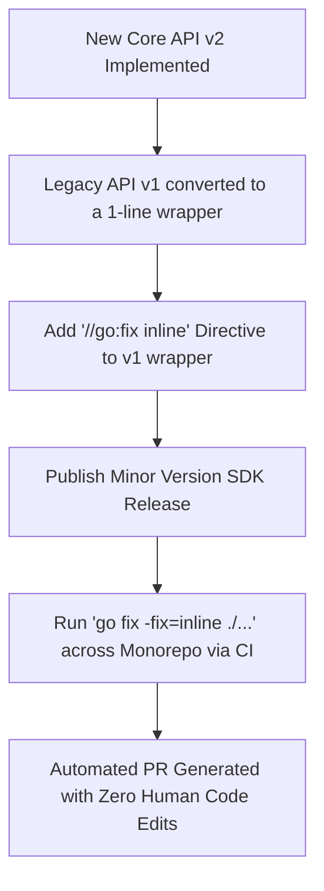

## Section 12B: Go 1.26 Source-Level Inlining (`//go:fix inline`)

Go 1.26 introduced the `//go:fix inline` compiler and tooling directive, transforming how library authors deprecate legacy APIs and how engineering organizations execute zero-friction refactors across large codebases.

> **Production Context & Article Reference**:
> This mechanism and its engineering implications are detailed by Wesley Wei in [*go:fix inline You Should Know in Golang*](https://wesley-wei.medium.com/list/you-should-know-in-golang-e9491363cd9a).

---

### 12B.1 The Deprecation Friction Problem

Historically in Go, when an API was deprecated in favor of a cleaner or more performant alternative (e.g., `io/ioutil.ReadFile` -> `os.ReadFile`), package maintainers added a doc comment:

```go
// Deprecated: Use os.ReadFile instead.
func ReadFile(filename string) ([]byte, error) {
    return os.ReadFile(filename)
}
```

While static analysis tools and IDEs flagged the deprecation, the actual migration burden fell entirely on downstream users:
1. Grepping thousands of call sites across microservices.
2. Manually rewriting each invocation.
3. Updating imports across hundreds of files.

Because of this friction, deprecated calls routinely survived in production codebases for 5+ years.

---

### 12B.2 The `//go:fix inline` Directive

With Go 1.26, a package author can mark thin wrapper functions with `//go:fix inline`:

```go
package mypkg

import "os"

// Deprecated: Use os.ReadFile directly.
//go:fix inline
func ReadFile(filename string) ([]byte, error) {
    return os.ReadFile(filename)
}
```

When client code runs:

```bash
go fix -fix=inline ./...
```

The Go toolchain uses its internal AST rewriter to:
1. Replace all call sites of `mypkg.ReadFile(path)` with `os.ReadFile(path)`.
2. Automatically add `import "os"` if missing.
3. Automatically remove `import "mypkg"` if no other identifiers from `mypkg` are referenced.

---

### 12B.3 Technical Inlining Challenges Solved by the Toolchain

Inlining at the source/AST level is non-trivial. The Go toolchain's inliner solves six critical edge cases:

1. **Parameter Side Effects**: If an argument has side effects (e.g., `ReadFile(nextFile())`), and the inlined body references the parameter more than once, the toolchain introduces an intermediate temporary assignment to guarantee single evaluation.
2. **Shadowed Identifiers**: If the target package imports a different package named `os`, or has a local variable `os`, the inliner qualifies the package name with a hygienic alias.
3. **Type Conversions**: In untyped constant contexts, the inliner preserves exact type inference rules so that constants do not trigger compiler type mismatch errors.
4. **Variadic Unpacking**: Functions using `...T` parameters are expanded correctly without creating redundant slice allocations.

---

### 12B.4 Enterprise Best Practices for Platform Teams

Platform and core infra teams owning internal SDKs should establish this migration workflow:


