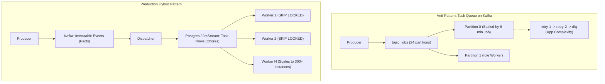

## Common Mistakes

### Mistake 1: Treating Kafka as a Message Queue (Not a Log)

**Wrong mental model**: Using Kafka partitions as task queues, deleting messages after consumption, setting short retention windows, or attempting individual message acknowledgments.

**Why it's wrong**: Kafka is an append-only *distributed commit log*, not an AMQP task queue. In the engineering retrospective [After 4 Years And 500M Events, I Finally Stopped Using Kafka As A Task Queue](https://medium.com/@arkprotocol/after-4-years-and-500m-events-i-finally-stopped-using-kafka-as-a-task-queue), author Ark Protocol explains the core distinction: *"Kafka is superb at facts. What left was chores. Order paid is a fact. Resize this image is a chore."*

When teams force Kafka to act as a worker queue, three architectural failure modes emerge:

1. **Range Offsets vs. Individual Acknowledgments**: Committing offset 5,000 marks all preceding offsets as resolved. If task 4,981 fails while tasks 4,982 through 5,000 succeed, the consumer cannot reject or retry only item 4,981 without stalling the partition. Teams compensate by building retry topic ladders (`retry-1`, `retry-2`, `dlq`) and committing the original offset prematurely, moving queue semantics into unmonitored application code.
2. **Partitions as Concurrency Ceilings**: A Kafka topic with 24 partitions can feed at most 24 active consumer workers; a 25th worker sits idle. Scaling out during load surges is impossible without repartitioning the topic, which re-hashes keys and breaks per-entity message ordering.
3. **Heartbeat Starvation in Long-Running Tasks**: If an individual task takes 6 minutes while `max.poll.interval.ms` is set to 5 minutes, the broker coordinator assumes the worker has died. The coordinator revokes the partition and reassigns it to another worker, which picks up the same failing 6-minute task, triggering continuous rebalance storms.



**Correct approach**: Keep immutable domain events ("order paid", "payment captured") in durable Kafka topics with long retention (7+ days). For asynchronous background jobs with variable processing durations ("generate PDF", "transcode video"), dispatch items into a task table using PostgreSQL `SELECT ... FOR UPDATE SKIP LOCKED` or a dedicated queue (RabbitMQ / NATS JetStream):

```go
// Topic configuration for event sourcing - 7 day retention minimum
topicConfig := map[string]string{
    "retention.ms":         "604800000", // 7 days
    "cleanup.policy":       "delete",
    "compression.type":     "lz4",
    "min.insync.replicas":  "2",
    "max.message.bytes":    "1048576",   // 1MB
}

// For event sourcing topics, consider log compaction + retention
eventSourceConfig := map[string]string{
    "cleanup.policy":            "compact,delete",
    "retention.ms":              "604800000",
    "min.compaction.lag.ms":     "3600000",  // 1 hour before compaction eligible
    "delete.retention.ms":       "86400000", // tombstones kept 1 day
}
```

```go
// Task queue worker using PostgreSQL FOR UPDATE SKIP LOCKED
// Allows 300+ concurrent workers without partition limits
func ClaimJobBatch(ctx context.Context, db *sql.DB, batchSize int) ([]Job, error) {
    query := `
        UPDATE jobs
        SET status = 'processing', locked_at = NOW()
        WHERE id IN (
            SELECT id FROM jobs
            WHERE status = 'pending' AND run_at <= NOW()
            ORDER BY priority DESC, run_at ASC
            LIMIT $1
            FOR UPDATE SKIP LOCKED
        )
        RETURNING id, payload, retry_count;
    `
    rows, err := db.QueryContext(ctx, query, batchSize)
    if err != nil {
        return nil, err
    }
    defer rows.Close()

    var jobs []Job
    for rows.Next() {
        var j Job
        if err := rows.Scan(&j.ID, &j.Payload, &j.RetryCount); err != nil {
            return nil, err
        }
        jobs = append(jobs, j)
    }
    return jobs, nil
}
```

---

### Mistake 2: Wrong Partition Key Strategy (Hot Partitions)

**Wrong**: Using user ID as partition key when you have celebrity users (millions of followers generating events). Using timestamps as keys (all traffic goes to one partition per time window).

**Why it's wrong**: Hot partitions mean 1 partition gets 90% of traffic while 99 partitions sit idle. This negates Kafka's parallelism and creates a throughput bottleneck.

**Correct approach**:

```go
// partitionKey handles celebrity/high-cardinality hot partition prevention
func partitionKey(userID string, messageType string) string {
    // Celebrity detection: pre-computed set of high-volume user IDs
    // refreshed every 5 minutes from Redis
    if isCelebrityUser(userID) {
        // Shard celebrities across 16 virtual partitions
        // Downstream consumers merge by userID for ordering
        shard := fnv32(userID) % 16
        return fmt.Sprintf("%s:shard:%d", userID, shard)
    }

    // Normal users: use userID directly for ordering guarantee
    return userID
}

func fnv32(s string) uint32 {
    h := fnv.New32a()
    h.Write([]byte(s))
    return h.Sum32()
}

// isCelebrityUser checks a local cache refreshed from Redis
func isCelebrityUser(userID string) bool {
    celebrityCache.RLock()
    defer celebrityCache.RUnlock()
    _, exists := celebrityCache.users[userID]
    return exists
}
```

---

### Mistake 3: Not Handling Consumer Rebalances Correctly

**Wrong**: Implementing `ConsumeClaim` without a proper `Cleanup()` hook, dropping in-flight messages during rebalance.

```go
// WRONG: Missing Cleanup hook - in-flight messages lost on rebalance
type BadConsumerHandler struct{}

func (h *BadConsumerHandler) Setup(_ sarama.ConsumerGroupSession) error   { return nil }
func (h *BadConsumerHandler) Cleanup(_ sarama.ConsumerGroupSession) error { return nil } // NO-OP!
func (h *BadConsumerHandler) ConsumeClaim(session sarama.ConsumerGroupSession, claim sarama.ConsumerGroupClaim) error {
    for msg := range claim.Messages() {
        go processAsync(msg) // goroutine leaks on rebalance!
        session.MarkMessage(msg, "")
    }
    return nil
}
```

**Correct approach**:

```go
type SafeConsumerHandler struct {
    wg sync.WaitGroup
}

func (h *SafeConsumerHandler) Setup(_ sarama.ConsumerGroupSession) error { return nil }

func (h *SafeConsumerHandler) Cleanup(_ sarama.ConsumerGroupSession) error {
    // Wait for all in-flight messages to finish processing before rebalance
    h.wg.Wait()
    return nil
}

func (h *SafeConsumerHandler) ConsumeClaim(session sarama.ConsumerGroupSession, claim sarama.ConsumerGroupClaim) error {
    for msg := range claim.Messages() {
        h.wg.Add(1)
        go func(m *sarama.ConsumerMessage) {
            defer h.wg.Done()
            if err := process(m); err == nil {
                session.MarkMessage(m, "")
            }
        }(msg)
    }
    return nil
}
```

---

### Mistake 4: Committing Offsets Before Processing Succeeds

**Wrong**: Auto-commit enabled, or committing before verifying the downstream write succeeded.

```go
// WRONG: auto.offset.reset=earliest + enable.auto.commit=true
// Message committed immediately after fetch, before processing
config.Consumer.Offsets.AutoCommit.Enable = true
config.Consumer.Offsets.AutoCommit.Interval = 1 * time.Second
```

**Correct approach**:

```go
// Disable auto-commit - commit only after successful processing
config.Consumer.Offsets.AutoCommit.Enable = false

// In your consume loop:
for msg := range claim.Messages() {
    if err := processWithDB(ctx, msg); err != nil {
        // Do NOT commit. Message will be redelivered after rebalance/restart.
        log.Error("processing failed, will retry", "offset", msg.Offset, "error", err)
        continue
    }
    // Only commit after confirmed success
    session.MarkMessage(msg, "")
}
```

---

### Mistake 5: Ignoring Producer Acknowledgment Errors

**Wrong**: Fire-and-forget with `RequireNone` acks, not reading from the error channel.

```go
// WRONG: fire-and-forget
writer := &kafka.Writer{
    Addr:         kafka.TCP("localhost:9092"),
    Topic:        "orders",
    RequiredAcks: kafka.RequireNone, // No acknowledgment!
    Async:        true,              // No error handling!
}
writer.WriteMessages(ctx, msg) // errors silently dropped
```

**Correct approach**:

```go
writer := &kafka.Writer{
    Addr:                   kafka.TCP("localhost:9092"),
    Topic:                  "orders",
    RequiredAcks:           kafka.RequireAll, // Wait for all ISR replicas
    Async:                  false,
    MaxAttempts:            3,
    WriteBackoffMin:        100 * time.Millisecond,
    WriteBackoffMax:        1 * time.Second,
    Compression:            kafka.Lz4,
}

if err := writer.WriteMessages(ctx, msg); err != nil {
    var writeErr kafka.WriteErrors
    if errors.As(err, &writeErr) {
        for i, e := range writeErr {
            if e != nil {
                log.Error("failed to write message", "index", i, "error", e)
                // Route to dead-letter queue or retry queue
                dlqWriter.WriteMessages(ctx, msg)
            }
        }
    }
    return fmt.Errorf("kafka write: %w", err)
}
```

---

### Mistake 6: Wrong Replication Factor and Min ISR Settings

**Wrong**: Running with `replication.factor=1` in production, or not setting `min.insync.replicas`.

| Setting | Development | Production |
|---|---|---|
| `replication.factor` | 1 | 3 |
| `min.insync.replicas` | 1 | 2 |
| `acks` (producer) | 1 | all (-1) |

**Correct topic creation**:

```go
topicConfig := &sarama.TopicDetail{
    NumPartitions:     24,
    ReplicationFactor: 3,
    ConfigEntries: map[string]*string{
        "min.insync.replicas": strPtr("2"),
        // With replication=3, min.isr=2: one broker can fail and writes succeed
        // If 2 brokers fail, writes fail with NotEnoughReplicasError (safe!)
    },
}
```

---

### Mistake 7: Not Monitoring Consumer Lag

**Wrong**: Only monitoring broker health and ignoring consumer lag, discovering outages when end-users complain.

**Correct approach** - expose consumer lag as a Prometheus metric:

```go
var (
    consumerLag = prometheus.NewGaugeVec(
        prometheus.GaugeOpts{
            Name: "kafka_consumer_lag",
            Help: "Number of messages behind the latest offset",
        },
        []string{"topic", "partition", "consumer_group"},
    )
)

func recordConsumerLag(topic string, partition int32, group string, lag int64) {
    consumerLag.WithLabelValues(
        topic,
        strconv.Itoa(int(partition)),
        group,
    ).Set(float64(lag))
}

// Alert threshold in Prometheus/AlertManager:
// alert: KafkaConsumerLagHigh
// expr: kafka_consumer_lag > 10000
// for: 2m
// severity: warning
//
// alert: KafkaConsumerLagCritical
// expr: kafka_consumer_lag > 100000
// for: 5m
// severity: critical
```

---

### Mistake 8: Using Kafka for the Wrong Use Cases

Kafka is not always the right tool. Understand the trade-offs:

| Use Case | Kafka? | Alternative |
|---|---|---|
| Event streaming & audit log | YES | - |
| Async inter-service processing | YES | - |
| Fan-out to multiple consumers | YES | - |
| Low-latency RPC (<10ms) | NO | gRPC, NATS |
| Job queue with priorities | NO | RabbitMQ, Asynq |
| Small scale (<1K msg/sec) | NO | NATS, Redis Streams |
| Request-reply patterns | NO | NATS, gRPC |
| Ephemeral pub/sub | NO | Redis Pub/Sub |

---

### Mistake 9: Schema Changes Without Backward Compatibility

**Wrong**: Renaming fields or removing required fields in Kafka message schemas.

```json
// v1 schema - existing consumers expect this
{"user_id": "123", "event": "purchase", "amount_cents": 9999}

// WRONG v2 schema - renames "user_id" to "userId", breaking all consumers
{"userId": "123", "event": "purchase", "amount_cents": 9999, "currency": "USD"}
```

**Correct - additive-only changes**:

```json
// CORRECT v2 schema - backward compatible
// Old consumers ignore unknown fields - new field "currency" has default
{"user_id": "123", "userId": "123", "event": "purchase", "amount_cents": 9999, "currency": "USD"}
```

Rules for backward-compatible Kafka schemas:
1. Never remove or rename fields
2. New fields must be optional with defaults
3. Never change field types
4. Use Schema Registry (Confluent or buf.build) to enforce compatibility

---

### Mistake 10: Ignoring Exactly-Once Complexity

**Wrong**: Assuming Kafka's `enable.idempotence=true` gives you exactly-once end-to-end.

**The three delivery semantics**:

- **At-most-once**: commit before processing. Messages can be lost on crash. Acceptable for metrics, logs.
- **At-least-once**: commit after processing. Messages may be reprocessed on crash. Requires idempotent consumers.
- **Exactly-once**: requires both idempotent producers AND idempotent consumers. Much harder.

**Idempotency key pattern with PostgreSQL**:

```go
// schema: CREATE TABLE processed_events (
//   idempotency_key TEXT PRIMARY KEY,
//   processed_at    TIMESTAMPTZ DEFAULT NOW()
// );

func processExactlyOnce(ctx context.Context, db *pgx.Conn, msg *kafka.Message) error {
    // Idempotency key = topic + partition + offset (globally unique)
    key := fmt.Sprintf("%s:%d:%d", msg.Topic, msg.Partition, msg.Offset)

    tx, err := db.Begin(ctx)
    if err != nil {
        return fmt.Errorf("begin transaction: %w", err)
    }
    defer tx.Rollback(ctx)

    // Try to claim this message - ON CONFLICT means already processed
    var alreadyProcessed bool
    err = tx.QueryRow(ctx, `
        INSERT INTO processed_events (idempotency_key)
        VALUES ($1)
        ON CONFLICT (idempotency_key) DO NOTHING
        RETURNING false
    `, key).Scan(&alreadyProcessed)

    if errors.Is(err, pgx.ErrNoRows) {
        // Conflict: already processed, safe to skip
        return nil
    }
    if err != nil {
        return fmt.Errorf("idempotency check: %w", err)
    }

    // Process the business logic within the same transaction
    if err := applyBusinessLogic(ctx, tx, msg); err != nil {
        return fmt.Errorf("business logic: %w", err)
    }

    return tx.Commit(ctx)
}
```

### Junior -> FAANG: Turning Common Mistakes into Code Review Checklist Items

Common mistakes sections are most valuable when converted into a concrete checklist you apply to your own code before submitting a pull request. For each mistake in this section, write a one-line checklist item that you can apply in 30 seconds:

- Treating Kafka as a message queue: does the topic retention allow for replay? Is `retention.ms` at least 7 days for business events?
- Wrong partition key causing hot partitions: does my partition key have high cardinality? Am I using a timestamp or sequential ID as the key?
- Missing `acks=all` and `min.insync.replicas=2`: are both of these set in my producer config?
- Auto-commit enabled with complex processing: is `enable.auto.commit=false` set for any consumer that performs external side effects?
- Not handling rebalance events: does my consumer implement `ConsumerRebalanceListener` to handle offset commits before partitions are revoked?
- Missing consumer lag monitoring: is there a Prometheus gauge for consumer lag in my service?

For interview preparation, common mistakes questions come in the form "what would you do differently if you had to rebuild this system" or "what are the most common Kafka anti-patterns you have seen." Having a concrete list of named mistakes with explanations and fixes makes these questions easy to answer confidently.

The hot partition mistake is frequently tested in systems design interviews. Practice explaining it in two minutes: the problem (one partition gets 90% of traffic), the cause (low-cardinality key like user tier), the detection (per-partition lag skew in consumer monitoring), and the fix (either higher-cardinality key, virtual sharding for celebrity entities, or overflow routing).

### Senior @ FAANG: Common Mistakes as Patterns for Code Review and Architecture Review

At the senior level, common mistakes become criteria for code review and architecture review. When reviewing a junior engineer's Kafka consumer implementation, you are not checking syntax. You are checking for the anti-patterns in this section.

**Code review checklist for Kafka consumers at the L5+ bar:**

1. Is `enable.auto.commit=false` set and are offsets committed only after successful processing? (at-least-once guarantee)
2. Is the consumer handler idempotent, with evidence in the code or tests? (safe for reprocessing after crash)
3. Is cooperative-sticky rebalancing configured? (`partition.assignment.strategy=CooperativeStickyAssignor` or equivalent in the Go client)
4. Is `group.instance.id` set from a stable identifier (pod name, not UUID)? (static membership)
5. Is consumer lag exported as a Prometheus metric? (operational observability from day one)
6. Is there a dead-letter topic and DLQ consumer, or is the error handling strategy documented with a justification for the chosen approach?
7. Is the partition key documented with its cardinality and hot partition risk assessment?
8. Is the `transactional.id` stable across restarts if transactions are used?

**Architecture review criteria for Kafka topic design at the L6 bar:**

1. Is the partition count justified by a throughput calculation, not a guess?
2. Is the retention period matched to the business use case (event sourcing needs longer retention than notification delivery)?
3. Is the cleanup policy (`delete` vs `compact` vs `compact,delete`) matched to the topic's semantic (event log vs current state)?
4. Are topic naming conventions followed (team-prefix, event-type, environment suffix)?
5. Is there a schema registered for the topic value, with a compatibility mode of FULL_TRANSITIVE?
6. Is there a DLQ topic defined and a runbook for handling DLQ messages?

These criteria exist because common mistakes in production are almost always violations of one of these criteria. A senior engineer who can articulate the full checklist in a code review is demonstrating exactly the kind of platform thinking that earns L6 ratings.

---
