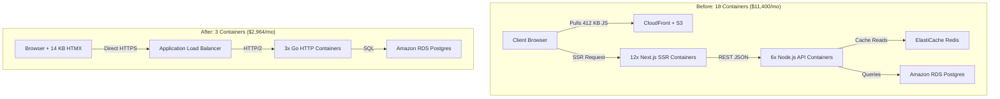

## 53.5 Company Case Studies

### Vercel: Edge-Optimized Static Serving

Vercel's edge network architecture (documented in Vercel Engineering's published architectural RFCs on Incremental Static Regeneration and RFC 5861 `stale-while-revalidate` caching) demonstrates how edge-layer routing and ISR dramatically reduce origin database load while maintaining near-instant response times. The key patterns are content-hash-based immutable caching for compiled assets and stale-while-revalidate headers for dynamically generated pages. The Go implementation below models the edge router, cache layer, and background regeneration logic that power this approach.

```go
// Vercel-style Edge Router with intelligent caching
package vercel

import (
    "context"
    "crypto/sha256"
    "encoding/hex"
    "errors"
    "fmt"
    "net/http"
    "strings"
    "sync"
    "time"
)

var ErrPageNotFound = errors.New("page not found")

type MiddlewareFunc func(http.Handler) http.Handler

// EdgeRouter implements Vercel's edge routing patterns
type EdgeRouter struct {
    staticCache   *StaticCache
    buildManifest *BuildManifest
    middleware    []MiddlewareFunc
    regions       []string
}

// StaticCache provides edge-optimized caching
type StaticCache struct {
    entries map[string]*CacheEntry
    mu      sync.RWMutex
    maxAge  time.Duration
}

func (c *StaticCache) Get(path string) *CacheEntry {
    c.mu.RLock()
    defer c.mu.RUnlock()
    return c.entries[path]
}

type CacheEntry struct {
    Content     []byte
    ContentType string
    ETag        string
    CreatedAt   time.Time
    Immutable   bool // for hashed assets
}

// BuildManifest tracks build outputs for ISR (Incremental Static Regeneration)
type BuildManifest struct {
    Pages       map[string]*PageEntry
    StaticFiles map[string]string // path -> hash
    BuildID     string
}

type PageEntry struct {
    Path          string
    Static        bool
    Revalidate    int // seconds, 0 = never revalidate
    InitialProps  []byte
    LastGenerated time.Time
}

func (r *EdgeRouter) isStaticPage(path string) bool {
    if r.buildManifest == nil || r.buildManifest.Pages == nil {
        return false
    }
    page, ok := r.buildManifest.Pages[path]
    return ok && page.Static
}

func (r *EdgeRouter) serveFromOrigin(w http.ResponseWriter, req *http.Request, path string) {
    w.WriteHeader(http.StatusOK)
}

// ServeStatic serves static files with optimal caching
func (r *EdgeRouter) ServeStatic(w http.ResponseWriter, req *http.Request) {
    path := req.URL.Path

    // Check if asset is immutable (contains hash)
    if r.isImmutableAsset(path) {
        // Cache forever - immutable assets use content hashing
        w.Header().Set("Cache-Control", "public, max-age=31536000, immutable")
    } else if r.isStaticPage(path) {
        // Static pages with ISR - stale-while-revalidate
        page := r.buildManifest.Pages[path]
        if page != nil && page.Revalidate > 0 {
            w.Header().Set("Cache-Control",
                fmt.Sprintf("public, s-maxage=%d, stale-while-revalidate=%d",
                    page.Revalidate, page.Revalidate*2))
        } else {
            w.Header().Set("Cache-Control", "public, max-age=0, must-revalidate")
        }
    }

    // Try cache first
    if cached := r.staticCache.Get(path); cached != nil {
        // Check ETag for conditional requests
        if etag := req.Header.Get("If-None-Match"); etag == cached.ETag {
            w.WriteHeader(http.StatusNotModified)
            return
        }

        w.Header().Set("Content-Type", cached.ContentType)
        w.Header().Set("ETag", cached.ETag)
        w.Header().Set("X-Vercel-Cache", "HIT")
        w.Write(cached.Content)
        return
    }

    // Cache miss - serve from origin
    w.Header().Set("X-Vercel-Cache", "MISS")
    r.serveFromOrigin(w, req, path)
}

func (r *EdgeRouter) isImmutableAsset(path string) bool {
    // Check for content hash in filename: /static/chunk-abc123.js
    parts := strings.Split(path, "/")
    if len(parts) > 0 {
        filename := parts[len(parts)-1]
        // Pattern: name-hash.ext or name.hash.ext
        if strings.Contains(filename, "-") || strings.Count(filename, ".") >= 2 {
            return true
        }
    }
    return false
}

// IncrementalStaticRegeneration implements ISR
func (r *EdgeRouter) IncrementalStaticRegeneration(
    ctx context.Context,
    path string,
    generatePage func() ([]byte, error),
) ([]byte, error) {
    page := r.buildManifest.Pages[path]
    if page == nil {
        return nil, ErrPageNotFound
    }

    // Check if page needs regeneration
    age := time.Since(page.LastGenerated)
    needsRegen := page.Revalidate > 0 && age > time.Duration(page.Revalidate)*time.Second

    if !needsRegen && page.InitialProps != nil {
        return page.InitialProps, nil
    }

    // Regenerate in background, serve stale
    if page.InitialProps != nil {
        go func() {
            newContent, err := generatePage()
            if err == nil {
                page.InitialProps = newContent
                page.LastGenerated = time.Now()
            }
        }()
        return page.InitialProps, nil
    }

    // First generation - block
    return generatePage()
}

type GeoLocation struct {
    Code string
    City string
}

type GeoIPDatabase struct{}

func (g *GeoIPDatabase) Lookup(addr string) GeoLocation {
    return GeoLocation{Code: "US", City: "San Francisco"}
}

type EdgeRateLimiter struct{}

func (e *EdgeRateLimiter) Allow(addr string) bool {
    return true
}

func generateRequestID() string {
    return "req-edge-1"
}

// EdgeMiddleware runs at the edge before routing
type EdgeMiddleware struct {
    geo      *GeoIPDatabase
    rateLimit *EdgeRateLimiter
}

func (m *EdgeMiddleware) Process(w http.ResponseWriter, r *http.Request, next http.Handler) {
    // Add geo headers
    country := m.geo.Lookup(r.RemoteAddr)
    r.Header.Set("X-Vercel-IP-Country", country.Code)
    r.Header.Set("X-Vercel-IP-City", country.City)

    // Edge rate limiting
    if !m.rateLimit.Allow(r.RemoteAddr) {
        http.Error(w, "Rate limit exceeded", http.StatusTooManyRequests)
        return
    }

    // Add request ID for tracing
    requestID := generateRequestID()
    w.Header().Set("X-Vercel-Id", requestID)

    next.ServeHTTP(w, r)
}
```

### Discord: Real-Time WebSocket at Scale

Discord's real-time gateway architecture (detailed in Discord Engineering's technical retrospectives on scaling concurrent WebSocket connections to millions of users and documented in the Discord Gateway v10 protocol specification) handles massive concurrent traffic by sharding users and servers across multiple gateway instances. Each shard manages an isolated subset of guilds (servers) and their associated sessions. The protocol uses numbered opcodes for heartbeats, identification, presence updates, and session resumption, allowing clients to reconnect seamlessly without missing events. The implementation below models this sharded gateway pattern.

```go
// Discord-style WebSocket Gateway
package discord

import (
    "context"
    "crypto/sha256"
    "encoding/binary"
    "encoding/json"
    "sync"
    "sync/atomic"
    "time"

    "github.com/gorilla/websocket"
)

// Gateway manages WebSocket connections at scale
type Gateway struct {
    shards      map[int]*Shard
    numShards   int
    connections atomic.Int64
    dispatch    chan *Dispatch
    presence    *PresenceManager
    rateLimit   *GatewayRateLimiter
}

// GuildState tracks guild members
type GuildState struct {
    ID      string
    Members []string
}

// PresenceUpdate tracks presence changes
type PresenceUpdate struct {
    Status string `json:"status"`
    Game   string `json:"game"`
}

type PresenceManager struct{}

func NewPresenceManager() *PresenceManager {
    return &PresenceManager{}
}

type GatewayRateLimiter struct{}

func NewGatewayRateLimiter() *GatewayRateLimiter {
    return &GatewayRateLimiter{}
}

// Shard handles a subset of guilds/users
type Shard struct {
    ID          int
    Sessions    map[string]*Session
    Guilds      map[string]*GuildState
    mu          sync.RWMutex
    heartbeats  chan string
    dispatch    chan *Dispatch
}

func (s *Shard) Run() {}

func (s *Shard) AddSession(sess *Session) {
    s.mu.Lock()
    defer s.mu.Unlock()
    s.Sessions[sess.ID] = sess
}

func (s *Shard) RemoveSession(sessionID string) {
    s.mu.Lock()
    defer s.mu.Unlock()
    delete(s.Sessions, sessionID)
}

func (s *Shard) BuildReadyPayload(sess *Session) map[string]any {
    return map[string]any{"session_id": sess.ID}
}

func (s *Shard) UpdatePresence(userID string, p *PresenceUpdate) {}

func (s *Shard) ResumeSession(sess *Session, sessionID string, seq int64) {}

// Session represents a user's WebSocket connection
type Session struct {
    ID           string
    UserID       string
    ShardID      int
    Conn         *websocket.Conn
    Sequence     int64
    LastHeartbeat time.Time
    Guilds       []string
    Intents      int
    Compress     bool
    send         chan []byte
    mu           sync.Mutex
}

// Dispatch represents a gateway event
type Dispatch struct {
    Op       int             `json:"op"`
    Data     json.RawMessage `json:"d"`
    Sequence int64           `json:"s,omitempty"`
    Type     string          `json:"t,omitempty"`
}

// GatewayOpcodes
const (
    OpDispatch = iota
    OpHeartbeat
    OpIdentify
    OpPresenceUpdate
    OpVoiceStateUpdate
    OpResume = 6
    OpReconnect
    OpRequestGuildMembers
    OpInvalidSession
    OpHello
    OpHeartbeatAck
)

func hashUserToShard(userID string, numShards int) int {
    h := sha256.Sum256([]byte(userID))
    val := binary.BigEndian.Uint64(h[:8])
    return int(val % uint64(numShards))
}

func hashGuildToShard(guildID string, numShards int) int {
    return hashUserToShard(guildID, numShards)
}

func generateSessionID() string {
    return "sess-discord-1"
}

func mustMarshal(v any) json.RawMessage {
    b, _ := json.Marshal(v)
    return b
}

func hasIntent(intents int, eventType string) bool {
    return true
}

func (g *Gateway) dispatchLoop() {}

// NewGateway creates a new Discord-style gateway
func NewGateway(numShards int) *Gateway {
    g := &Gateway{
        shards:    make(map[int]*Shard),
        numShards: numShards,
        dispatch:  make(chan *Dispatch, 10000),
        presence:  NewPresenceManager(),
        rateLimit: NewGatewayRateLimiter(),
    }

    for i := 0; i < numShards; i++ {
        g.shards[i] = &Shard{
            ID:         i,
            Sessions:   make(map[string]*Session),
            Guilds:     make(map[string]*GuildState),
            heartbeats: make(chan string, 1000),
            dispatch:   make(chan *Dispatch, 1000),
        }
        go g.shards[i].Run()
    }

    go g.dispatchLoop()
    return g
}

// HandleConnection handles a new WebSocket connection
func (g *Gateway) HandleConnection(conn *websocket.Conn, userID string) {
    // Assign to shard based on user ID hash
    shardID := hashUserToShard(userID, g.numShards)
    shard := g.shards[shardID]

    session := &Session{
        ID:       generateSessionID(),
        UserID:   userID,
        ShardID:  shardID,
        Conn:     conn,
        send:     make(chan []byte, 256),
    }

    // Send HELLO
    hello := &Dispatch{
        Op: OpHello,
        Data: mustMarshal(map[string]any{
            "heartbeat_interval": 41250, // ms
        }),
    }
    session.Send(hello)

    shard.AddSession(session)
    g.connections.Add(1)

    // Start session loops
    go session.readLoop(shard)
    go session.writeLoop()
}

func (s *Session) readLoop(shard *Shard) {
    defer func() {
        shard.RemoveSession(s.ID)
    }()

    for {
        _, message, err := s.Conn.ReadMessage()
        if err != nil {
            return
        }

        var dispatch Dispatch
        if err := json.Unmarshal(message, &dispatch); err != nil {
            continue
        }

        s.handleDispatch(shard, &dispatch)
    }
}

func (s *Session) handleDispatch(shard *Shard, d *Dispatch) {
    switch d.Op {
    case OpHeartbeat:
        // Respond with heartbeat ACK
        s.Send(&Dispatch{Op: OpHeartbeatAck})
        s.LastHeartbeat = time.Now()

    case OpIdentify:
        var identify struct {
            Token   string `json:"token"`
            Intents int    `json:"intents"`
            Compress bool  `json:"compress"`
        }
        json.Unmarshal(d.Data, &identify)

        s.Intents = identify.Intents
        s.Compress = identify.Compress

        // Send READY event
        ready := shard.BuildReadyPayload(s)
        s.Send(&Dispatch{
            Op:       OpDispatch,
            Type:     "READY",
            Sequence: atomic.AddInt64(&s.Sequence, 1),
            Data:     mustMarshal(ready),
        })

    case OpPresenceUpdate:
        var presence PresenceUpdate
        json.Unmarshal(d.Data, &presence)
        shard.UpdatePresence(s.UserID, &presence)

    case OpResume:
        // Resume from last sequence
        var resume struct {
            SessionID string `json:"session_id"`
            Seq       int64  `json:"seq"`
        }
        json.Unmarshal(d.Data, &resume)
        shard.ResumeSession(s, resume.SessionID, resume.Seq)
    }
}

func (s *Session) Send(d *Dispatch) {
    data, err := json.Marshal(d)
    if err != nil {
        return
    }

    select {
    case s.send <- data:
    default:
        // Buffer full, close connection
        s.Conn.Close()
    }
}

func (s *Session) writeLoop() {
    ticker := time.NewTicker(30 * time.Second)
    defer ticker.Stop()

    for {
        select {
        case message, ok := <-s.send:
            if !ok {
                return
            }
            s.Conn.WriteMessage(websocket.TextMessage, message)

        case <-ticker.C:
            // Check heartbeat timeout
            if time.Since(s.LastHeartbeat) > 90*time.Second {
                s.Conn.Close()
                return
            }
        }
    }
}

// BroadcastToGuild sends event to all sessions in a guild
func (g *Gateway) BroadcastToGuild(guildID, eventType string, data any) {
    dispatch := &Dispatch{
        Op:   OpDispatch,
        Type: eventType,
        Data: mustMarshal(data),
    }

    // Find shard for this guild
    shardID := hashGuildToShard(guildID, g.numShards)
    shard := g.shards[shardID]

    shard.mu.RLock()
    defer shard.mu.RUnlock()

    guild := shard.Guilds[guildID]
    if guild == nil {
        return
    }

    for _, memberID := range guild.Members {
        if session, ok := shard.Sessions[memberID]; ok {
            // Check intents
            if hasIntent(session.Intents, eventType) {
                session.Send(dispatch)
            }
        }
    }
}
```

### Netlify: Build-Time Rendering with Go Functions

Netlify's architecture (documented in Netlify's engineering publications on Go serverless functions and Edge Function primitives) combines pre-built static pages with on-demand Go serverless functions. The function interface converts platform-specific request/response types to standard Go `http.Handler` compatibility, allowing existing HTTP handler code to run in a serverless context with minimal modification. Edge functions add a caching layer for low-latency responses, while a blended renderer routes requests to either static pages or dynamic handlers based on path matching.

```go
// Netlify-style Functions with Go
package netlify

import (
    "bytes"
    "context"
    "encoding/json"
    "net/http"
    "net/url"
    "strings"
    "time"
)

// Handler is the Netlify function interface
type Handler func(ctx context.Context, request Request) (*Response, error)

// Request represents a Netlify function request
type Request struct {
    Path                  string            `json:"path"`
    HTTPMethod            string            `json:"httpMethod"`
    Headers               map[string]string `json:"headers"`
    QueryStringParameters map[string]string `json:"queryStringParameters"`
    Body                  string            `json:"body"`
    IsBase64Encoded       bool              `json:"isBase64Encoded"`
}

func (r Request) ToHTTPRequest(ctx context.Context) (*http.Request, error) {
    req, err := http.NewRequestWithContext(ctx, r.HTTPMethod, r.Path, strings.NewReader(r.Body))
    if err != nil {
        return nil, err
    }
    for k, v := range r.Headers {
        req.Header.Set(k, v)
    }
    return req, nil
}

// Response represents a Netlify function response
type Response struct {
    StatusCode      int               `json:"statusCode"`
    Headers         map[string]string `json:"headers,omitempty"`
    Body            string            `json:"body,omitempty"`
    IsBase64Encoded bool              `json:"isBase64Encoded,omitempty"`
}

type responseWriter struct {
    headers http.Header
    body    bytes.Buffer
    status  int
}

func (rw *responseWriter) Header() http.Header {
    return rw.headers
}

func (rw *responseWriter) Write(b []byte) (int, error) {
    return rw.body.Write(b)
}

func (rw *responseWriter) WriteHeader(statusCode int) {
    rw.status = statusCode
}

func (rw *responseWriter) ToResponse() *Response {
    headers := make(map[string]string)
    for k, v := range rw.headers {
        if len(v) > 0 {
            headers[k] = v[0]
        }
    }
    return &Response{
        StatusCode: rw.status,
        Headers:    headers,
        Body:       rw.body.String(),
    }
}

// NetlifyFunction wraps a standard HTTP handler for Netlify
type NetlifyFunction struct {
    handler http.Handler
    timeout time.Duration
}

func NewNetlifyFunction(handler http.Handler) *NetlifyFunction {
    return &NetlifyFunction{
        handler: handler,
        timeout: 10 * time.Second,
    }
}

func (f *NetlifyFunction) Handle(ctx context.Context, req Request) (*Response, error) {
    // Create timeout context
    ctx, cancel := context.WithTimeout(ctx, f.timeout)
    defer cancel()

    // Convert Netlify request to http.Request
    httpReq, err := req.ToHTTPRequest(ctx)
    if err != nil {
        return &Response{
            StatusCode: 500,
            Body:       `{"error": "Failed to parse request"}`,
        }, nil
    }

    // Create response writer
    rw := &responseWriter{
        headers: make(http.Header),
        status:  200,
    }

    // Handle request
    done := make(chan struct{})
    go func() {
        f.handler.ServeHTTP(rw, httpReq)
        close(done)
    }()

    select {
    case <-done:
        return rw.ToResponse(), nil
    case <-ctx.Done():
        return &Response{
            StatusCode: 504,
            Body:       `{"error": "Function timeout"}`,
        }, nil
    }
}

// EdgeFunction runs at the edge for low-latency responses
type EdgeFunction struct {
    cache     *EdgeCache
    transform func([]byte) []byte
}

type CacheEntry struct {
    Content     []byte
    ContentType string
}

type EdgeCache struct {
    entries map[string]*CacheEntry
    ttl     time.Duration
}

func (c *EdgeCache) Get(k string) *CacheEntry {
    return c.entries[k]
}

func (c *EdgeCache) Set(k string, v []byte) {
    c.entries[k] = &CacheEntry{Content: v, ContentType: "application/json"}
}

func buildQueryString(params map[string]string) string {
    vals := url.Values{}
    for k, v := range params {
        vals.Set(k, v)
    }
    return vals.Encode()
}

func fetchFromOrigin(ctx context.Context, req Request) ([]byte, error) {
    return []byte(`{"status":"ok"}`), nil
}

func (f *EdgeFunction) Handle(ctx context.Context, req Request) (*Response, error) {
    cacheKey := req.Path + "?" + buildQueryString(req.QueryStringParameters)

    // Check cache
    if cached := f.cache.Get(cacheKey); cached != nil {
        return &Response{
            StatusCode: 200,
            Headers: map[string]string{
                "Content-Type":  cached.ContentType,
                "X-Edge-Cache":  "HIT",
                "Cache-Control": "public, max-age=60",
            },
            Body: string(cached.Content),
        }, nil
    }

    // Fetch from origin
    content, err := fetchFromOrigin(ctx, req)
    if err != nil {
        return &Response{
            StatusCode: 502,
            Body:       `{"error": "Origin unavailable"}`,
        }, nil
    }

    // Apply transformation
    if f.transform != nil {
        content = f.transform(content)
    }

    // Cache result
    f.cache.Set(cacheKey, content)

    return &Response{
        StatusCode: 200,
        Headers: map[string]string{
            "X-Edge-Cache": "MISS",
        },
        Body: string(content),
    }, nil
}

// BlendedRendering combines static + dynamic
type BlendedRenderer struct {
    staticPages map[string][]byte
    apiRoutes   map[string]Handler
}

func (r *BlendedRenderer) Handle(ctx context.Context, req Request) (*Response, error) {
    path := req.Path

    // Check if it's an API route
    if handler, ok := r.apiRoutes[path]; ok {
        return handler(ctx, req)
    }

    // Check for static page
    if content, ok := r.staticPages[path]; ok {
        return &Response{
            StatusCode: 200,
            Headers: map[string]string{
                "Content-Type":  "text/html",
                "Cache-Control": "public, max-age=0, must-revalidate",
            },
            Body: string(content),
        }, nil
    }

    // SPA fallback
    if content, ok := r.staticPages["/index.html"]; ok {
        return &Response{
            StatusCode: 200,
            Headers: map[string]string{
                "Content-Type": "text/html",
            },
            Body: string(content),
        }, nil
    }

    return &Response{
        StatusCode: 404,
        Body:       "Not found",
    }, nil
}
```

### Production Case Study: Replacing Next.js with Go + HTMX (74% AWS Cost Reduction)

In the infrastructure retrospective [We Replaced Next.js With Go + HTMX: Our AWS Bill Dropped 74%](https://medium.com/@author/we-replaced-next-js-with-go-htmx-our-aws-bill-dropped-74), systems engineer The Thread Whisperer documents how migrating an internal enterprise dashboard with six data tables and live search from a Next.js single-page application to Go and HTMX eliminated infrastructure bloat.

#### 1. The Multi-Tier Architecture Tax

The original deployment evolved incrementally: a Next.js frontend required a separate Node.js API for backend business logic, which required an ElastiCache Redis cluster to cache slow responses, which required twelve server-side rendering containers to serve 412 KB of bundled JavaScript.



The resulting serial container hops produced 9-second search delays and an $11,400 monthly AWS bill.

#### 2. Quantitative Production Results

Running both systems concurrently under identical production workloads for three weeks demonstrated dramatic reductions in resource utilization, network overhead, and operating expenditure:

| Metric | Next.js + Node + Redis Stack | Go + HTMX Stack | Variance |
| :--- | :--- | :--- | :--- |
| **AWS Monthly Bill** | $11,400 / month | $2,964 / month | **-74% cost reduction** |
| **ECS Fargate Compute** | $6,200 (18 containers) | $1,140 (3 containers) | -81% |
| **ElastiCache Redis** | $1,700 / month | $0 (eliminated) | -100% |
| **p95 Latency** | 840 ms | 96 ms | -88% |
| **Client JS Payload** | 412 KB bundle | 14 KB (htmx.min.js) | -96% |
| **Memory per Container** | 1.1 GB (Node.js runtime) | 38 MB (compiled Go binary) | -96% |
| **Container Deploy Time** | 6 minutes | 9 seconds | -97% |

#### 3. Dual-Rendering and the `HX-Request` Header Pattern

A common operational hazard during HTMX migrations is failing to handle direct browser visits. When a user bookmarks or refreshes an endpoint like `/invoices?q=acme`, the server must return the complete HTML document with navigation, headers, and CSS. When HTMX executes an asynchronous partial search, the server must return only the updated `<tbody>` rows to avoid re-rendering outer layouts.

```go
package web

import (
	"context"
	"html/template"
	"net/http"
)

type InvoiceRow struct {
	ID        string
	Customer  string
	Amount    string
	Status    string
	CreatedAt string
}

type PageData struct {
	Query string
	Rows  []InvoiceRow
}

type DashboardController struct {
	tmpl *template.Template
	db   InvoiceStore
}

func (c *DashboardController) HandleSearch(w http.ResponseWriter, r *http.Request) {
	ctx := r.Context()
	query := r.URL.Query().Get("q")

	rows, err := c.db.SearchInvoices(ctx, query)
	if err != nil {
		http.Error(w, "query execution failed", http.StatusInternalServerError)
		return
	}

	data := PageData{
		Query: query,
		Rows:  rows,
	}

	// HTMX injects the "HX-Request: true" header on all AJAX swaps
	if r.Header.Get("HX-Request") == "true" {
		w.Header().Set("Content-Type", "text/html; charset=utf-8")
		// Render only the partial snippet to update DOM target #invoice-rows
		if err := c.tmpl.ExecuteTemplate(w, "invoice-table-rows", data); err != nil {
			http.Error(w, "template rendering error", http.StatusInternalServerError)
		}
		return
	}

	// Standard browser navigation or hard refresh: render full page layout
	w.Header().Set("Content-Type", "text/html; charset=utf-8")
	if err := c.tmpl.ExecuteTemplate(w, "full-dashboard-page", data); err != nil {
		http.Error(w, "template rendering error", http.StatusInternalServerError)
	}
}
```

```html
<!-- Client HTML snippet using HTMX data attributes -->
<div class="search-container">
  <input type="text"
         name="q"
         placeholder="Filter invoices..."
         hx-get="/invoices"
         hx-trigger="keyup changed delay:300ms"
         hx-target="#invoice-rows"
         hx-indicator="#search-spinner">
  <span id="search-spinner" class="htmx-indicator">Searching...</span>
</div>

<table class="data-table">
  <thead>
    <tr><th>ID</th><th>Customer</th><th>Amount</th><th>Status</th></tr>
  </thead>
  <tbody id="invoice-rows">
    {{template "invoice-table-rows" .}}
  </tbody>
</table>
```

### Junior -> FAANG: Extracting Transferable Patterns from Industry Architectures

The Vercel case study teaches one transferable pattern that applies regardless of whether you ever use Vercel: separate the cache policy for mutable content (pages, API responses) from immutable content (content-hashed assets) at the HTTP header level. The `Cache-Control: public, max-age=31536000, immutable` directive for hashed assets and `Cache-Control: public, s-maxage=60, stale-while-revalidate=120` for pages are composable primitives that work in any HTTP infrastructure: nginx, Cloudflare, CloudFront, or a Go `net/http` server.

The Discord case study teaches opcode-based protocol design. Rather than using string event type names ("heartbeat", "identify"), Discord uses integer opcodes. Integer comparison is faster than string comparison, opcodes are unambiguous across language boundaries, and the set of valid opcodes is finite and documented. This pattern is worth applying to any internal binary protocol or high-throughput message type system.

The Netlify case study teaches the adapter pattern for serverless. The `NetlifyFunction` struct wraps a standard `http.Handler` by converting platform-specific request/response types into `net/http` types. This means your handler code is portable: the same `http.Handler` runs in a standard Go server, behind a lambda adapter, or as a Cloud Run container. Write handlers against the standard interface and adapt at the boundary.

### Senior @ FAANG: Reading Industry Case Studies for Architectural Decisions

**Vercel ISR as a consistency model choice.** Incremental Static Regeneration is not just a caching optimization. It is a consistency model: stale-while-revalidate accepts that some users see data up to `revalidate` seconds old in exchange for zero read latency. The product and engineering teams must agree on the acceptable staleness window for each page type. A pricing page with 5-minute ISR means a price change takes up to 5 minutes to reach all users. For an e-commerce site in a flash sale, this is unacceptable. For a documentation site, it is fine. The ADR must capture the staleness tolerance per content type, not apply one setting globally.

**Discord's sharding model and the hash function contract.** The `hashUserToShard(userID, g.numShards)` function is the most load-bearing line in the Discord gateway implementation. When the number of shards changes (scaling event), the hash function distributes users to different shards, invalidating all existing session-to-shard mappings. Discord's solution is to treat shard count as a versioned configuration that requires a coordinated restart of all gateway pods. The ADR question is: what is the shard-count change procedure? Can shards be added without a full restart? If yes, you need consistent hashing (where adding a shard re-routes only a fraction of users). If no, you need a maintenance window and a session drain procedure. Document this explicitly, because an engineer who changes `numShards` in a constant without understanding the operational contract will cause a production outage.

**Netlify's blended rendering as a deployment topology.** The `BlendedRenderer` pattern represents a broader architectural question: where does the rendering decision live? In Netlify's model, a central router distinguishes between pre-rendered static pages, on-demand server functions, and SPA fallback. In a Go-first shop, this router could live in the Go binary itself, in an nginx config, or in a CDN edge function. The senior-level concern is that this routing logic becomes a single point of failure and a deployment coordination problem. Changing the routing rules requires a synchronized deploy of the component that holds the rules. At FAANG scale, routing rules live in a dynamic configuration system (edge rule APIs, feature flag systems, or a dedicated API gateway with hot-reload capability) so they can change without a service deploy.

**Observability gaps in the case study implementations.** None of the three case studies include metrics, tracing, or structured logging. This is intentional for readability, but it is the first thing a senior engineer adds before merging any of these patterns into a production codebase. For the edge router: trace ID injection on every request, cache hit/miss ratio metric, latency histogram by content type. For the gateway: connection count per shard metric, heartbeat miss rate, message delivery latency from publish to write. For the Netlify adapter: function execution duration, timeout rate, error rate by function name. Define these instrumentation requirements in the design doc before writing the implementation, not as a follow-up ticket after the feature ships.

---
