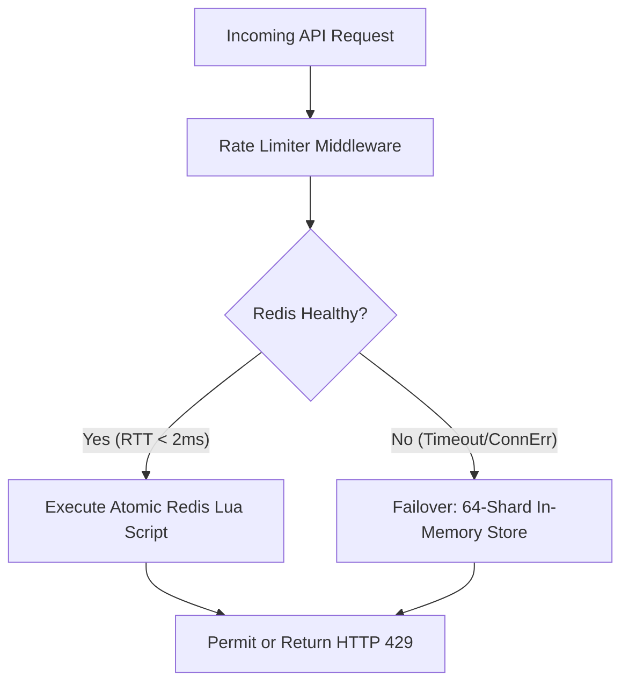

## 59.4 Distributed Rate Limiting

Rate limiting in distributed systems requires coordination across multiple nodes. A per-instance limiter is straightforward but allows clients to multiply their effective rate by hitting different instances behind a load balancer. The three algorithms below, sliding window, token bucket, and leaky bucket, each use Redis as a shared counter so that rate limits are enforced globally regardless of which instance handles the request.

### Sliding Window Rate Limiter

A sliding window rate limiter provides more accurate enforcement than a fixed window because it counts requests over a rolling time period rather than resetting at fixed intervals, eliminating the boundary burst problem where clients can double their rate by straddling a window boundary. The Redis-based implementation uses sorted sets, storing each request as a member scored by its timestamp, so the window can be queried with `ZCOUNT` and expired entries pruned with `ZREMRANGEBYSCORE` in a single Lua script for atomicity. This approach scales across multiple service instances because Redis acts as the shared counter, ensuring rate limits are enforced globally rather than per-instance.

```go
// ratelimit/sliding_window.go
package ratelimit

import (
    "context"
    "fmt"
    "time"

    "github.com/redis/go-redis/v9"
)

// SlidingWindowLimiter implements sliding window rate limiting
type SlidingWindowLimiter struct {
    client     *redis.Client
    keyPrefix  string
    limit      int64
    windowSize time.Duration
}

// NewSlidingWindowLimiter creates a new sliding window limiter
func NewSlidingWindowLimiter(client *redis.Client, prefix string, limit int64, window time.Duration) *SlidingWindowLimiter {
    return &SlidingWindowLimiter{
        client:     client,
        keyPrefix:  prefix,
        limit:      limit,
        windowSize: window,
    }
}

// Allow checks if a request is allowed
func (s *SlidingWindowLimiter) Allow(ctx context.Context, key string) (bool, error) {
    now := time.Now().UnixMicro()
    windowStart := now - s.windowSize.Microseconds()
    redisKey := fmt.Sprintf("%s:%s", s.keyPrefix, key)

    // Lua script for atomic sliding window rate limiting
    script := redis.NewScript(`
        local key = KEYS[1]
        local now = tonumber(ARGV[1])
        local window_start = tonumber(ARGV[2])
        local limit = tonumber(ARGV[3])
        local window_size = tonumber(ARGV[4])

        -- Remove old entries
        redis.call("ZREMRANGEBYSCORE", key, "-inf", window_start)

        -- Count current entries
        local count = redis.call("ZCARD", key)

        if count < limit then
            -- Add new entry using deterministic sequence counter to ensure replica safety
            local seq = redis.call("INCR", key .. ":seq")
            redis.call("PEXPIRE", key .. ":seq", window_size / 1000)
            redis.call("ZADD", key, now, now .. "-" .. seq)
            redis.call("PEXPIRE", key, window_size / 1000)
            return 1
        end

        return 0
    `)

    result, err := script.Run(ctx, s.client, []string{redisKey}, now, windowStart, s.limit, s.windowSize.Microseconds()).Int64()
    if err != nil {
        return false, err
    }

    return result == 1, nil
}

// AllowN checks if N requests are allowed
func (s *SlidingWindowLimiter) AllowN(ctx context.Context, key string, n int64) (bool, error) {
    now := time.Now().UnixMicro()
    windowStart := now - s.windowSize.Microseconds()
    redisKey := fmt.Sprintf("%s:%s", s.keyPrefix, key)

    script := redis.NewScript(`
        local key = KEYS[1]
        local now = tonumber(ARGV[1])
        local window_start = tonumber(ARGV[2])
        local limit = tonumber(ARGV[3])
        local window_size = tonumber(ARGV[4])
        local n = tonumber(ARGV[5])

        redis.call("ZREMRANGEBYSCORE", key, "-inf", window_start)
        local count = redis.call("ZCARD", key)

        if count + n <= limit then
            local seq = redis.call("INCRBY", key .. ":seq", n)
            redis.call("PEXPIRE", key .. ":seq", window_size / 1000)
            for i = 1, n do
                redis.call("ZADD", key, now, now .. "-" .. (seq - n + i))
            end
            redis.call("PEXPIRE", key, window_size / 1000)
            return 1
        end

        return 0
    `)

    result, err := script.Run(ctx, s.client, []string{redisKey}, now, windowStart, s.limit, s.windowSize.Microseconds(), n).Int64()
    if err != nil {
        return false, err
    }

    return result == 1, nil
}

// Status returns the current rate limit status
func (s *SlidingWindowLimiter) Status(ctx context.Context, key string) (*LimitStatus, error) {
    now := time.Now().UnixMicro()
    windowStart := now - s.windowSize.Microseconds()
    redisKey := fmt.Sprintf("%s:%s", s.keyPrefix, key)

    // Remove old entries and count
    pipe := s.client.Pipeline()
    pipe.ZRemRangeByScore(ctx, redisKey, "-inf", fmt.Sprintf("%d", windowStart))
    countCmd := pipe.ZCard(ctx, redisKey)

    _, err := pipe.Exec(ctx)
    if err != nil {
        return nil, err
    }

    count := countCmd.Val()

    return &LimitStatus{
        Limit:     s.limit,
        Remaining: s.limit - count,
        ResetAt:   time.Now().Add(s.windowSize),
    }, nil
}

// LimitStatus represents the current rate limit status
type LimitStatus struct {
    Limit     int64
    Remaining int64
    ResetAt   time.Time
}
```

### Token Bucket Rate Limiter

The token bucket algorithm allows bursting up to the bucket's capacity while enforcing a sustained average rate, which better matches real API usage patterns than a hard per-interval counter. Tokens accumulate at a fixed rate up to the capacity ceiling. Each request consumes one token, and if the bucket is empty the request is rejected or queued. Because token count and last-refill timestamp are the only state needed, both fit in two Redis keys, and the Lua script recalculates the current token balance by multiplying elapsed seconds by the token rate, making the bucket effectively continuous without requiring a background refill goroutine.

```go
// ratelimit/token_bucket.go
package ratelimit

import (
    "context"
    "fmt"
    "math"
    "strconv"
    "time"

    "github.com/redis/go-redis/v9"
)

// TokenBucketLimiter implements distributed token bucket rate limiting
type TokenBucketLimiter struct {
    client     *redis.Client
    keyPrefix  string
    capacity   int64         // Maximum tokens
    rate       float64       // Tokens per second
    refillTime time.Duration // Time to fully refill bucket
}

// NewTokenBucketLimiter creates a new token bucket limiter
func NewTokenBucketLimiter(client *redis.Client, prefix string, capacity int64, rate float64) *TokenBucketLimiter {
    return &TokenBucketLimiter{
        client:     client,
        keyPrefix:  prefix,
        capacity:   capacity,
        rate:       rate,
        refillTime: time.Duration(float64(capacity)/rate) * time.Second,
    }
}

// Allow checks if a request is allowed (consumes 1 token)
func (t *TokenBucketLimiter) Allow(ctx context.Context, key string) (bool, error) {
    return t.AllowN(ctx, key, 1)
}

// AllowN checks if N tokens can be consumed
func (t *TokenBucketLimiter) AllowN(ctx context.Context, key string, tokens int64) (bool, error) {
    now := time.Now().UnixMicro()
    tokensKey := fmt.Sprintf("%s:tokens:%s", t.keyPrefix, key)
    lastRefillKey := fmt.Sprintf("%s:lastrefill:%s", t.keyPrefix, key)

    // Lua script for atomic token bucket
    script := redis.NewScript(`
        local tokens_key = KEYS[1]
        local last_refill_key = KEYS[2]
        local capacity = tonumber(ARGV[1])
        local rate = tonumber(ARGV[2])
        local now = tonumber(ARGV[3])
        local requested = tonumber(ARGV[4])

        -- Get current state
        local tokens = tonumber(redis.call("GET", tokens_key) or capacity)
        local last_refill = tonumber(redis.call("GET", last_refill_key) or now)

        -- Calculate tokens to add based on time elapsed
        local elapsed = (now - last_refill) / 1000000  -- Convert to seconds
        local new_tokens = math.min(capacity, tokens + (elapsed * rate))

        if new_tokens >= requested then
            -- Consume tokens
            new_tokens = new_tokens - requested
            redis.call("SET", tokens_key, new_tokens)
            redis.call("SET", last_refill_key, now)
            -- Set expiry for cleanup
            redis.call("EXPIRE", tokens_key, math.ceil(capacity / rate) + 1)
            redis.call("EXPIRE", last_refill_key, math.ceil(capacity / rate) + 1)
            return 1
        end

        -- Update state without consuming
        redis.call("SET", tokens_key, new_tokens)
        redis.call("SET", last_refill_key, now)
        return 0
    `)

    result, err := script.Run(ctx, t.client, []string{tokensKey, lastRefillKey}, t.capacity, t.rate, now, tokens).Int64()
    if err != nil {
        return false, err
    }

    return result == 1, nil
}

// Reserve reserves tokens and returns wait time if needed
func (t *TokenBucketLimiter) Reserve(ctx context.Context, key string, tokens int64) (time.Duration, error) {
    now := time.Now().UnixMicro()
    tokensKey := fmt.Sprintf("%s:tokens:%s", t.keyPrefix, key)
    lastRefillKey := fmt.Sprintf("%s:lastrefill:%s", t.keyPrefix, key)

    script := redis.NewScript(`
        local tokens_key = KEYS[1]
        local last_refill_key = KEYS[2]
        local capacity = tonumber(ARGV[1])
        local rate = tonumber(ARGV[2])
        local now = tonumber(ARGV[3])
        local requested = tonumber(ARGV[4])

        local tokens = tonumber(redis.call("GET", tokens_key) or capacity)
        local last_refill = tonumber(redis.call("GET", last_refill_key) or now)

        local elapsed = (now - last_refill) / 1000000
        local new_tokens = math.min(capacity, tokens + (elapsed * rate))

        -- Calculate wait time if needed
        if new_tokens < requested then
            local deficit = requested - new_tokens
            local wait_seconds = deficit / rate
            return math.ceil(wait_seconds * 1000000)  -- Return microseconds
        end

        -- Consume tokens
        new_tokens = new_tokens - requested
        redis.call("SET", tokens_key, new_tokens)
        redis.call("SET", last_refill_key, now)
        redis.call("EXPIRE", tokens_key, math.ceil(capacity / rate) + 1)
        redis.call("EXPIRE", last_refill_key, math.ceil(capacity / rate) + 1)
        return 0
    `)

    result, err := script.Run(ctx, t.client, []string{tokensKey, lastRefillKey}, t.capacity, t.rate, now, tokens).Int64()
    if err != nil {
        return 0, err
    }

    return time.Duration(result) * time.Microsecond, nil
}

// Status returns the current bucket status
func (t *TokenBucketLimiter) Status(ctx context.Context, key string) (*BucketStatus, error) {
    now := time.Now().UnixMicro()
    tokensKey := fmt.Sprintf("%s:tokens:%s", t.keyPrefix, key)
    lastRefillKey := fmt.Sprintf("%s:lastrefill:%s", t.keyPrefix, key)

    pipe := t.client.Pipeline()
    tokensCmd := pipe.Get(ctx, tokensKey)
    lastRefillCmd := pipe.Get(ctx, lastRefillKey)
    pipe.Exec(ctx)

    tokens := float64(t.capacity)
    if tokensStr, err := tokensCmd.Result(); err == nil {
        if t, err := strconv.ParseFloat(tokensStr, 64); err == nil {
            tokens = t
        }
    }

    lastRefill := now
    if lastRefillStr, err := lastRefillCmd.Result(); err == nil {
        if lr, err := strconv.ParseInt(lastRefillStr, 10, 64); err == nil {
            lastRefill = lr
        }
    }

    // Calculate current tokens
    elapsed := float64(now-lastRefill) / 1000000
    currentTokens := math.Min(float64(t.capacity), tokens+(elapsed*t.rate))

    return &BucketStatus{
        Capacity:      t.capacity,
        CurrentTokens: int64(currentTokens),
        Rate:          t.rate,
    }, nil
}

// BucketStatus represents the current bucket state
type BucketStatus struct {
    Capacity      int64
    CurrentTokens int64
    Rate          float64
}
```

### Leaky Bucket Rate Limiter

The leaky bucket algorithm enforces a smooth, constant output rate regardless of how bursty the incoming traffic is. Incoming requests fill a queue, and the queue drains at a fixed rate. If the queue is already full when a new request arrives, that request is rejected rather than queued, providing strict backpressure. Unlike the token bucket, which allows a burst up to capacity at any moment, the leaky bucket guarantees downstream systems never see more than `rate` requests per second, making it the right choice when protecting a backend that cannot tolerate sudden spikes even if the average rate is within limits. The Lua script models the queue drain by computing `elapsed * rate` and subtracting that from the stored queue size on every request.

```go
// ratelimit/leaky_bucket.go
package ratelimit

import (
    "context"
    "fmt"
    "time"

    "github.com/redis/go-redis/v9"
)

// LeakyBucketLimiter implements distributed leaky bucket rate limiting
// Provides smooth, constant rate output regardless of burst input
type LeakyBucketLimiter struct {
    client    *redis.Client
    keyPrefix string
    rate      float64 // Requests per second (leak rate)
    capacity  int64   // Maximum queue size
}

// NewLeakyBucketLimiter creates a new leaky bucket limiter
func NewLeakyBucketLimiter(client *redis.Client, prefix string, rate float64, capacity int64) *LeakyBucketLimiter {
    return &LeakyBucketLimiter{
        client:    client,
        keyPrefix: prefix,
        rate:      rate,
        capacity:  capacity,
    }
}

// Allow checks if a request is allowed
func (l *LeakyBucketLimiter) Allow(ctx context.Context, key string) (bool, error) {
    now := time.Now().UnixMicro()
    queueKey := fmt.Sprintf("%s:queue:%s", l.keyPrefix, key)
    lastLeakKey := fmt.Sprintf("%s:lastleak:%s", l.keyPrefix, key)

    script := redis.NewScript(`
        local queue_key = KEYS[1]
        local last_leak_key = KEYS[2]
        local rate = tonumber(ARGV[1])
        local capacity = tonumber(ARGV[2])
        local now = tonumber(ARGV[3])

        -- Get current state
        local queue_size = tonumber(redis.call("GET", queue_key) or 0)
        local last_leak = tonumber(redis.call("GET", last_leak_key) or now)

        -- Calculate how many whole requests have leaked out. Advance
        -- last_leak only by the time those requests consumed, NOT to
        -- now: resetting to now would discard fractional progress, and
        -- with requests arriving faster than 1/rate apart the floor()
        -- would always be zero and the queue would never drain.
        local elapsed = (now - last_leak) / 1000000  -- seconds
        local leaked = math.floor(elapsed * rate)
        if leaked > 0 then
            queue_size = math.max(0, queue_size - leaked)
            last_leak = last_leak + math.floor(leaked / rate * 1000000)
        end

        if queue_size < capacity then
            -- Add request to queue
            queue_size = queue_size + 1
            redis.call("SET", queue_key, queue_size)
            redis.call("SET", last_leak_key, last_leak)
            -- Set expiry
            local ttl = math.ceil(capacity / rate) + 1
            redis.call("EXPIRE", queue_key, ttl)
            redis.call("EXPIRE", last_leak_key, ttl)
            return 1
        end

        -- Queue full, reject request
        redis.call("SET", queue_key, queue_size)
        redis.call("SET", last_leak_key, last_leak)
        return 0
    `)

    result, err := script.Run(ctx, l.client, []string{queueKey, lastLeakKey}, l.rate, l.capacity, now).Int64()
    if err != nil {
        return false, err
    }

    return result == 1, nil
}

// WaitTime returns how long to wait before the next request will be allowed
func (l *LeakyBucketLimiter) WaitTime(ctx context.Context, key string) (time.Duration, error) {
    now := time.Now().UnixMicro()
    queueKey := fmt.Sprintf("%s:queue:%s", l.keyPrefix, key)
    lastLeakKey := fmt.Sprintf("%s:lastleak:%s", l.keyPrefix, key)

    script := redis.NewScript(`
        local queue_key = KEYS[1]
        local last_leak_key = KEYS[2]
        local rate = tonumber(ARGV[1])
        local capacity = tonumber(ARGV[2])
        local now = tonumber(ARGV[3])

        local queue_size = tonumber(redis.call("GET", queue_key) or 0)
        local last_leak = tonumber(redis.call("GET", last_leak_key) or now)

        local elapsed = (now - last_leak) / 1000000
        local leaked = math.floor(elapsed * rate)
        if leaked > 0 then
            queue_size = math.max(0, queue_size - leaked)
        end

        if queue_size < capacity then
            return 0
        end

        -- Calculate wait time for one slot to free up
        local excess = queue_size - capacity + 1
        local wait_seconds = excess / rate
        return math.ceil(wait_seconds * 1000000)
    `)

    result, err := script.Run(ctx, l.client, []string{queueKey, lastLeakKey}, l.rate, l.capacity, now).Int64()
    if err != nil {
        return 0, err
    }

    return time.Duration(result) * time.Microsecond, nil
}
```

### Production Case Study: 28 Million Decisions/sec with Zero Allocations and Sharded Fallback

In [28 Million Decisions Per Second. Zero Allocations. One Rate Limiter](https://medium.com/@bishweshwarshome/28-million-decisions-per-second-zero-allocations-one-rate-limiter), software engineer Bishweshwar Shome details the production architecture of RateShield, demonstrating how to achieve microsecond-latency distributed rate limiting while surviving Redis crashes.

#### 1. The 64-Shard Mutex Contention Solution

A naive in-memory rate limiter protects a single `map[string]*Entry` with a single `sync.Mutex`. Under 10,000 concurrent goroutines, CPU profiles reveal that worker threads spend over 70% of their runtime blocked on lock contention rather than evaluating limits.

To solve this, RateShield partitions the keyspace across 64 independent shards using the FNV-1a 64-bit non-cryptographic hash function. Because distinct client IPs hash to different shards, concurrent requests execute in parallel without colliding on the same lock.

```go
package ratelimit

import (
	"context"
	"sync"
	"time"
)

const numShards = 64

type ShardedMemoryLimiter struct {
	shards [numShards]*shard
}

type shard struct {
	mu      sync.RWMutex
	entries map[string]*bucketEntry
}

type bucketEntry struct {
	tokens     float64
	lastRefill time.Time
}

func fnv1a(key string) uint64 {
	var hash uint64 = 14695981039346656037 // FNV offset basis
	for i := 0; i < len(key); i++ {
		hash ^= uint64(key[i])
		hash *= 1099511628211 // FNV prime
	}
	return hash
}

func (m *ShardedMemoryLimiter) getShard(key string) *shard {
	return m.shards[fnv1a(key)%numShards]
}

func NewShardedMemoryLimiter() *ShardedMemoryLimiter {
	limiter := &ShardedMemoryLimiter{}
	for i := 0; i < numShards; i++ {
		limiter.shards[i] = &shard{
			entries: make(map[string]*bucketEntry),
		}
	}
	return limiter
}

// Allow executes in 34.84 ns/op with 0 allocations
func (m *ShardedMemoryLimiter) Allow(key string, capacity, refillRate float64) bool {
	s := m.getShard(key)
	s.mu.Lock()
	defer s.mu.Unlock()

	now := time.Now()
	entry, exists := s.entries[key]
	if !exists {
		s.entries[key] = &bucketEntry{
			tokens:     capacity - 1.0,
			lastRefill: now,
		}
		return true
	}

	// Token bucket refill formula
	elapsed := now.Sub(entry.lastRefill).Seconds()
	entry.tokens += elapsed * refillRate
	if entry.tokens > capacity {
		entry.tokens = capacity
	}
	entry.lastRefill = now

	if entry.tokens >= 1.0 {
		entry.tokens -= 1.0
		return true
	}
	return false
}
```

Benchmark results on modern hardware demonstrate **34.84 ns/op** and **0 B/op (0 allocs)**, delivering approximately 28.7 million decisions per second per CPU core without triggering GC pauses.

#### 2. Redis Cluster Script Determinism

Distributed rate limiters that execute Redis Lua scripts must enforce deterministic execution. A common bug is generating member identifiers with `math.random()` in Lua scripts when updating sliding window sorted sets. In Redis Cluster and replica topologies, non-deterministic functions cause master-replica divergence, as replicas replaying the script evaluate different random values. The solution is replacing `math.random()` with atomic Redis sequence counters (`INCR`), maintaining deterministic replication consistency.

#### 3. The FallbackStore Architecture

When Redis nodes fail or face transient network partitions, an API gateway must not fail-closed (rejecting all valid customers) or fail-open indefinitely (exposing backends to traffic spikes). RateShield implements an automated two-tier fallback:



If Redis returns a network timeout or connection error, the limiter delegates immediately to the local `ShardedMemoryLimiter`. Once Redis health checks recover, traffic transitions back to global Redis counters without dropping in-flight requests.

### Junior -> FAANG: Choosing the Right Algorithm for the Right Access Pattern

The three algorithms in this section are not interchangeable: each trades off burst tolerance against smoothness in a different way, and picking the wrong one for your use case creates either unhappy clients or overwhelmed backends.

Sliding window is the most accurate for "no more than N requests in any T-second window." It prevents the boundary burst (a client sending N requests just before midnight and N requests just after) that breaks fixed-window counters. The cost is memory proportional to the number of recent requests (the sorted set grows with request volume), and the Lua script does a `ZCARD` plus a `ZREMRANGEBYSCORE` on every request.

Token bucket is the right choice when clients have legitimate bursty traffic patterns. An API that receives 100 requests in one second, then nothing for nine seconds, should be allowed to burst if its sustained rate is under the limit. Token bucket allows this because tokens accumulate while the bucket is idle. It is the algorithm behind `golang.org/x/time/rate` and AWS API Gateway's burst capacity.

Leaky bucket is correct when your downstream cannot tolerate bursts at all. A batch processing pipeline that breaks under sudden load spikes benefits from leaky bucket because the output rate is strictly constant. Requests queue in the bucket and drain at the configured rate. No burst is ever passed through.

For interviews, practice drawing a timeline diagram showing a fixed-window counter being exploited at boundary edges and explaining how a sliding window prevents it. Know that the ZSET approach has O(log N) insertion and O(N) pruning per window, which is fine for moderate request rates but problematic at very high throughput (10k+ rps per key) where a local-first approach with periodic sync to Redis is preferred.

### Senior @ FAANG: Distributed Rate Limiting at Platform Scale

At FAANG scale, rate limiting is a platform service, not a library. The reasons are practical: if rate limiting lives in each service, quota management requires coordination across services to set per-tenant limits. Changing a limit requires deploying to every service. Observability is fragmented. A dedicated rate-limit service (like Envoy's external authorization filter or Google's Doorman) centralizes these concerns.

The key architectural tension is accuracy versus availability. A centralized rate-limit service that is down means either all traffic passes (fail-open) or all traffic is blocked (fail-closed). Neither is acceptable. The production answer is the hybrid model from the interview question section: local token buckets serve the hot path with eventual consistency to a shared store, and the shared store is used only for periodic reconciliation. This gives you approximately correct global enforcement with microsecond local latency and graceful degradation when Redis is unavailable.

Quota allocation across a fleet of service instances is the deeper problem. If you have 100 instances and a global limit of 1,000 rps, a naive approach gives each instance 10 rps. But load is not uniform: some instances handle 3x the average. An instance at 30 rps will reject requests that the global quota would have allowed because the other 99 instances are using less than their share. The solution is dynamic quota allocation: instances that approach their local quota request additional tokens from the central store, and instances with unused quota offer tokens back. Google's Doorman paper describes this protocol in detail.

ADR framing for rate limiter strategy: if your service has fewer than 100 clients per rate-limited entity and request volume is under 10k rps, the sliding window Lua script is operationally simple and correct. If you have millions of client IDs (user-level rate limiting at API gateway scale), the sorted set grows proportionally and you need the token bucket approach with lazy initialization. If you have a heterogeneous fleet where some clients need burst allowances and others need strict smoothing, implement both and select per-client based on a configuration table.

Observability requirement for rate limiters at senior level: every rejection must emit a metric with client ID, limit, current count, and the algorithm that rejected it. Without this, you cannot distinguish between "our limit is correct and clients are misbehaving" and "our limit is too tight and we are rejecting legitimate traffic." The former requires client-side fixes. The latter requires a configuration change.

---
