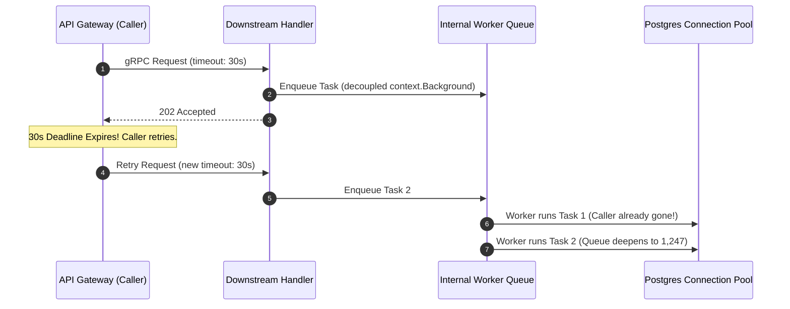

## 59.5 Circuit Breaker Pattern

The circuit breaker prevents cascading failures by failing fast when a downstream service is unhealthy. It operates as a state machine with three states: **Closed** (normal operation, requests pass through), **Open** (all requests are immediately rejected), and **Half-Open** (a limited number of probe requests test whether the service has recovered). The breaker transitions from Closed to Open when failures exceed a threshold, waits for a configurable timeout, then moves to Half-Open to test recovery. A mutex guards all state transitions and counter updates so the breaker is safe for concurrent use from multiple goroutines.

```go
// circuitbreaker/breaker.go
package circuitbreaker

import (
    "context"
    "errors"
    "sync"
    "time"
)

// State represents the circuit breaker state
type State int

const (
    StateClosed   State = iota // Normal operation
    StateOpen                  // Failing fast
    StateHalfOpen              // Testing if service recovered
)

func (s State) String() string {
    switch s {
    case StateClosed:
        return "closed"
    case StateOpen:
        return "open"
    case StateHalfOpen:
        return "half-open"
    default:
        return "unknown"
    }
}

var (
    ErrCircuitOpen = errors.New("circuit breaker is open")
)

// CircuitBreaker implements the circuit breaker pattern
type CircuitBreaker struct {
    mu sync.RWMutex

    name             string
    state            State

    // Configuration
    failureThreshold int           // Failures to open circuit
    successThreshold int           // Successes to close circuit
    timeout          time.Duration // How long to wait before half-open

    // Counters
    failures       int
    successes      int
    halfOpenProbes int // Probes issued while half-open

    // Timing
    lastFailure time.Time
    lastSuccess time.Time
    openedAt    time.Time

    // Callbacks
    onStateChange func(name string, from, to State)
}

// Options for circuit breaker configuration
type Options struct {
    FailureThreshold int
    SuccessThreshold int
    Timeout          time.Duration
    OnStateChange    func(name string, from, to State)
}

// DefaultOptions returns sensible defaults
func DefaultOptions() Options {
    return Options{
        FailureThreshold: 5,
        SuccessThreshold: 2,
        Timeout:          30 * time.Second,
    }
}

// New creates a new circuit breaker
func New(name string, opts Options) *CircuitBreaker {
    if opts.FailureThreshold <= 0 {
        opts.FailureThreshold = 5
    }
    if opts.SuccessThreshold <= 0 {
        opts.SuccessThreshold = 2
    }
    if opts.Timeout <= 0 {
        opts.Timeout = 30 * time.Second
    }

    return &CircuitBreaker{
        name:             name,
        state:            StateClosed,
        failureThreshold: opts.FailureThreshold,
        successThreshold: opts.SuccessThreshold,
        timeout:          opts.Timeout,
        onStateChange:    opts.OnStateChange,
    }
}

// Execute runs a function with circuit breaker protection
func (cb *CircuitBreaker) Execute(fn func() error) error {
    if !cb.AllowRequest() {
        return ErrCircuitOpen
    }

    err := fn()
    cb.RecordResult(err)
    return err
}

// ExecuteWithContext runs a function with context and circuit breaker protection
func (cb *CircuitBreaker) ExecuteWithContext(ctx context.Context, fn func(context.Context) error) error {
    if !cb.AllowRequest() {
        return ErrCircuitOpen
    }

    // Check context before executing
    select {
    case <-ctx.Done():
        return ctx.Err()
    default:
    }

    err := fn(ctx)
    cb.RecordResult(err)
    return err
}

// AllowRequest checks if a request should be allowed
func (cb *CircuitBreaker) AllowRequest() bool {
    cb.mu.Lock()
    defer cb.mu.Unlock()

    switch cb.state {
    case StateClosed:
        return true

    case StateOpen:
        // Check if timeout has passed
        if time.Since(cb.openedAt) >= cb.timeout {
            cb.transitionTo(StateHalfOpen)
            return true
        }
        return false

    case StateHalfOpen:
        // Allow only a bounded number of probes. Letting every request
        // through while half-open would recreate the load the breaker
        // was shedding, one slow downstream would absorb full traffic
        // the moment the timeout elapsed.
        if cb.halfOpenProbes < cb.successThreshold {
            cb.halfOpenProbes++
            return true
        }
        return false
    }

    return false
}

// RecordResult records the result of an operation
func (cb *CircuitBreaker) RecordResult(err error) {
    cb.mu.Lock()
    defer cb.mu.Unlock()

    if err != nil {
        cb.recordFailure()
    } else {
        cb.recordSuccess()
    }
}

func (cb *CircuitBreaker) recordFailure() {
    cb.lastFailure = time.Now()
    cb.successes = 0

    switch cb.state {
    case StateClosed:
        cb.failures++
        if cb.failures >= cb.failureThreshold {
            cb.transitionTo(StateOpen)
        }

    case StateHalfOpen:
        // Any failure in half-open goes back to open
        cb.transitionTo(StateOpen)
    }
}

func (cb *CircuitBreaker) recordSuccess() {
    cb.lastSuccess = time.Now()
    cb.failures = 0

    switch cb.state {
    case StateHalfOpen:
        cb.successes++
        if cb.successes >= cb.successThreshold {
            cb.transitionTo(StateClosed)
        }

    case StateClosed:
        cb.successes++
    }
}

func (cb *CircuitBreaker) transitionTo(newState State) {
    if cb.state == newState {
        return
    }

    oldState := cb.state
    cb.state = newState
    cb.failures = 0
    cb.successes = 0
    cb.halfOpenProbes = 0

    if newState == StateOpen {
        cb.openedAt = time.Now()
    }

    if cb.onStateChange != nil {
        go cb.onStateChange(cb.name, oldState, newState)
    }
}

// State returns the current state
func (cb *CircuitBreaker) State() State {
    cb.mu.RLock()
    defer cb.mu.RUnlock()
    return cb.state
}

// Stats returns circuit breaker statistics
func (cb *CircuitBreaker) Stats() Stats {
    cb.mu.RLock()
    defer cb.mu.RUnlock()

    return Stats{
        State:       cb.state,
        Failures:    cb.failures,
        Successes:   cb.successes,
        LastFailure: cb.lastFailure,
        LastSuccess: cb.lastSuccess,
    }
}

// Stats represents circuit breaker statistics
type Stats struct {
    State       State
    Failures    int
    Successes   int
    LastFailure time.Time
    LastSuccess time.Time
}

// Reset manually resets the circuit breaker to closed state
func (cb *CircuitBreaker) Reset() {
    cb.mu.Lock()
    defer cb.mu.Unlock()

    cb.transitionTo(StateClosed)
}
```

### Circuit Breaker with Fallback

When the circuit is open, returning an error to the caller may be too disruptive, a stale cache value or a default response is often preferable. The `FallbackBreaker` wraps the core breaker with a typed fallback function so that open-circuit rejections and transient failures both route to the same recovery path, keeping the caller's API surface uniform. Using Go generics here eliminates the type assertions that a plain `interface{}` approach would require at every call site.

```go
// circuitbreaker/fallback.go
package circuitbreaker

import (
    "context"
    "time"
)

// FallbackBreaker extends circuit breaker with fallback support
type FallbackBreaker[T any] struct {
    *CircuitBreaker
    fallback func(error) (T, error)
}

// NewWithFallback creates a circuit breaker with a fallback function
func NewWithFallback[T any](name string, opts Options, fallback func(error) (T, error)) *FallbackBreaker[T] {
    return &FallbackBreaker[T]{
        CircuitBreaker: New(name, opts),
        fallback:       fallback,
    }
}

// Execute runs the function with fallback support
func (fb *FallbackBreaker[T]) Execute(fn func() (T, error)) (T, error) {
    if !fb.AllowRequest() {
        if fb.fallback != nil {
            return fb.fallback(ErrCircuitOpen)
        }
        var zero T
        return zero, ErrCircuitOpen
    }

    result, err := fn()
    fb.RecordResult(err)

    if err != nil && fb.fallback != nil {
        return fb.fallback(err)
    }

    return result, err
}

// ExecuteWithTimeout runs with timeout and fallback (deprecated in favor of context-based timeout)
func (fb *FallbackBreaker[T]) ExecuteWithTimeout(timeout time.Duration, fn func() (T, error)) (T, error) {
    if !fb.AllowRequest() {
        if fb.fallback != nil {
            return fb.fallback(ErrCircuitOpen)
        }
        var zero T
        return zero, ErrCircuitOpen
    }

    resultCh := make(chan struct {
        result T
        err    error
    }, 1)

    go func() {
        result, err := fn()
        resultCh <- struct {
            result T
            err    error
        }{result, err}
    }()

    select {
    case res := <-resultCh:
        fb.RecordResult(res.err)
        if res.err != nil && fb.fallback != nil {
            return fb.fallback(res.err)
        }
        return res.result, res.err

    case <-time.After(timeout):
        fb.RecordResult(context.DeadlineExceeded)
        if fb.fallback != nil {
            return fb.fallback(context.DeadlineExceeded)
        }
        var zero T
        return zero, context.DeadlineExceeded
    }
}
```

### The Timeout Fallacy: Why context.WithTimeout Is Not a Circuit Breaker

Engineers often mistake caller timeouts for circuit breakers. In the incident analysis [context.WithTimeout Is Not a Circuit Breaker](https://medium.com/@syarif/context-withtimeout-is-not-a-circuit-breaker), systems engineer Syarif documents how an architecture with strict 30-second client timeouts triggered an escalating downstream outage.

The upstream service called a downstream pricing engine using `context.WithTimeout(ctx, 30*time.Second)`. On the caller dashboard, p99 latency was flat at 30.000 seconds. However, downstream was in a critical state: CPU was pinned at 94%, and the PostgreSQL connection pool (capacity: 60) remained fully saturated.



The root cause was architectural decoupling at the goroutine handoff boundary:
1. **Asynchronous Goroutine Handoff**: The downstream handler validated requests and enqueued them into an in-process worker queue. To prevent an abandoned client HTTP/gRPC connection from interrupting in-flight multi-table transactions mid-write, the worker began transactions using `context.Background()`.
2. **Retry Amplification**: When the caller hit the 30-second deadline, its client-side retry policy executed a second attempt with another 30-second budget.
3. **Ghost Processing**: Because the downstream worker ignored caller cancellation, the original task continued executing. Retries stacked on top of un-canceled tasks, ballooning the worker queue from nominal to 1,247 jobs. Over 31% of total CPU cycles were spent executing computations whose callers had disconnected minutes earlier.

#### The Three-Part Production Remedy

```go
package pricing

import (
	"context"
	"errors"
	"sync"
	"time"

	"github.com/sony/gobreaker"
	"google.golang.org/grpc/codes"
	"google.golang.org/grpc/status"
)

type RecalcJob struct {
	Ctx       context.Context
	Cancel    context.CancelFunc
	SKU       string
	StoreID   string
	Requested time.Time
}

type PricingServer struct {
	workQueue chan RecalcJob
}

// 1. Boundary Context with Explicit Bounded Lifetime
func (s *PricingServer) RecalculatePrice(ctx context.Context, sku, storeID string) error {
	// Preserve trace baggage without binding to client socket lifecycle,
	// but strictly enforce an independent execution deadline.
	jobCtx, cancel := context.WithTimeout(context.WithoutCancel(ctx), 45*time.Second)

	job := RecalcJob{
		Ctx:       jobCtx,
		Cancel:    cancel,
		SKU:       sku,
		StoreID:   storeID,
		Requested: time.Now(),
	}

	select {
	case s.workQueue <- job:
		return nil
	default:
		cancel()
		return status.Error(codes.ResourceExhausted, "in-process queue saturated")
	}
}

// 2. Pre-Execution Admission Check in Worker
func (s *PricingServer) ProcessWorker(job RecalcJob, dbRun func(context.Context) error) {
	defer job.Cancel()

	// If the job sat in queue past its execution deadline, drop it immediately
	// before acquiring connection pool slots or executing queries.
	if err := job.Ctx.Err(); err != nil {
		return
	}

	_ = dbRun(job.Ctx)
}

// 3. Client-Side Circuit Breaker to Halt Ingress Floods
func NewPricingBreaker() *gobreaker.CircuitBreaker {
	return gobreaker.NewCircuitBreaker(gobreaker.Settings{
		Name:        "pricing-service",
		MaxRequests: 5,
		Interval:    10 * time.Second,
		Timeout:     30 * time.Second,
		ReadyToTrip: func(counts gobreaker.Counts) bool {
			failureRatio := float64(counts.TotalFailures) / float64(counts.Requests)
			return counts.Requests >= 15 && failureRatio >= 0.60
		},
	})
}
```

A client timeout only bounds how long the caller waits; it does not reduce the load imposed on downstream infrastructure. True resilience requires coordinating client-side circuit breakers (which stop sending traffic when failure ratios rise) with worker-side admission checks (which reject stale jobs before executing database transactions).

### Junior -> FAANG: Understanding the Three States and Their Transitions

The circuit breaker's state machine is simple, but juniors frequently get the transition logic wrong under interview pressure. Memorize the three rules: Closed transitions to Open when the failure count exceeds the threshold. Open transitions to Half-Open after the timeout elapses (not immediately). Half-Open transitions to Closed if enough probe requests succeed, or back to Open if any probe request fails.

The critical subtlety is the Half-Open state. Its purpose is to probe the downstream service with a small amount of real traffic before fully reopening. If you allow unlimited requests in Half-Open, you recreate the problem the breaker was solving. The `successThreshold` parameter (typically 2 to 5 probe successes) is the knob that controls how confident you need to be before fully reopening.

For your first job, the most important habit to build is not implementing circuit breakers from scratch. Libraries like `sony/gobreaker`, `mercari/go-circuitbreaker`, or the built-in Hystrix-compatible `afex/hystrix-go` exist and are tested in production. Write your own only to understand the internals, then reach for a library in production code.

For interviews, know how to answer "what failure threshold is appropriate for your service?" The answer involves: the service's baseline error rate under normal conditions (a service with 0.1% normal errors needs a threshold above 0.1%), the traffic volume (a threshold of 5 failures means nothing on a service handling 100k rps, but is meaningful on a service handling 50 rps), and the impact of being wrong (a payment service should be conservative, a recommendation service can be more aggressive).

### Senior @ FAANG: Circuit Breaker Governance and the Cost of Getting Thresholds Wrong

The most expensive circuit breaker incident is not the breaker failing to open. It is the breaker opening unnecessarily during a transient blip and staying open for minutes while on-call engineers debug why traffic is being shed. This is a threshold governance problem.

The production solution is percentage-based thresholds with minimum request volume, as shown in the Netflix Hystrix section. The minimum request volume (20 requests default in Hystrix) prevents the breaker from opening during startup or low-traffic periods when a single slow request would trigger a simple count-based threshold. The error percentage (50% default) means the service must be genuinely failing before the breaker trips.

Error classification is the other lever. Not all errors should count toward the trip threshold. A `context.Canceled` error usually means the client gave up, not that the downstream is unhealthy. A 429 (Too Many Requests) means the downstream is overloaded but functional. Tripping the breaker in response adds insult to injury by also dropping the requests that would have succeeded after a brief wait. Classify errors as: fatal (count toward threshold), transient (do not count), and client errors (do not count). This requires your error types to carry sufficient semantic information, which means your internal error types need an `IsTransient() bool` method or similar.

Observability is non-negotiable at the senior level. Every state transition must emit a structured event: breaker name, previous state, new state, timestamp, and the metrics that triggered the transition (failure count, failure percentage, request volume in the evaluation window). Without this, debugging a breaker trip during an incident requires code reading rather than log querying.

Staff-level concern: circuit breakers and retries interact. A retry inside a circuit breaker means each individual attempt is independently evaluated. A circuit breaker outside a retry means the breaker evaluates the final outcome after all retries have been exhausted. The second composition is usually correct: you want the breaker to see sustained failures after retries have already tried to recover, not individual transient errors that retries would have fixed. Document this ordering decision in your service's architecture decision record.

ADR question: should circuit breakers live in the client (each service decides when to stop calling a downstream) or in the infrastructure (service mesh, API gateway)? Client-side gives you more granular control and error-type awareness. Infrastructure-side gives you centralized observability and applies consistently regardless of client language. Most mature organizations use both: service mesh for coarse-grained protection and client-side for business-logic-aware error classification.

---
