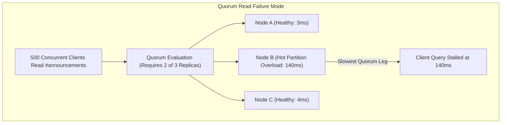

## 59.10 Company Case Studies

### Discord: Consistent Hashing for Message Routing

As detailed in Discord Engineering's architectural retrospective ("How Discord Scaled Elixir to 5,000,000 Concurrent Users", 2017; "How Discord Stores Billions of Messages", 2017), Discord routes millions of messages per second across a sharded infrastructure. Their routing layer uses consistent hashing to assign guilds (servers) to processing shards, combined with guild affinity to maintain message ordering within each guild. When a shard becomes unhealthy, traffic is redistributed to neighboring shards on the hash ring with minimal disruption to unaffected guilds.

```go
// discord_message_router.go
// Inspired by Discord's message routing architecture
package discord

import (
    "context"
    "crypto/sha256"
    "encoding/binary"
    "fmt"
    "sort"
    "sync"
    "sync/atomic"
    "time"
)

// GuildRouter routes messages to appropriate shards using consistent hashing
type GuildRouter struct {
    mu           sync.RWMutex
    ring         []uint64
    shardMap     map[uint64]*Shard
    virtualNodes int
    shards       []*Shard
    totalMsgs    atomic.Uint64

    // Discord uses guild ID affinity for message ordering
    guildAffinity map[string]*Shard
    affinityMu    sync.RWMutex
}

// Shard represents a message processing worker pool
type Shard struct {
    ID          string
    Endpoint    string
    Weight      int      // Higher weight = more virtual nodes
    MessageChan chan *Message
    Health      atomic.Bool
    MsgCount    atomic.Uint64
}

// Message represents a Discord message
type Message struct {
    ID        string
    GuildID   string
    ChannelID string
    AuthorID  string
    Content   string
    Timestamp time.Time
    Nonce     string // For idempotency
}

// NewGuildRouter creates a new consistent hash router
func NewGuildRouter(shards []*Shard, virtualNodes int) *GuildRouter {
    router := &GuildRouter{
        ring:          make([]uint64, 0),
        shardMap:      make(map[uint64]*Shard),
        virtualNodes:  virtualNodes,
        shards:        shards,
        guildAffinity: make(map[string]*Shard),
    }

    for _, shard := range shards {
        router.addShardToRing(shard)
    }

    return router
}

func (r *GuildRouter) addShardToRing(shard *Shard) {
    // Weight affects number of virtual nodes
    vnodes := r.virtualNodes * shard.Weight

    for i := 0; i < vnodes; i++ {
        hash := r.hash(fmt.Sprintf("%s:%d", shard.ID, i))
        r.ring = append(r.ring, hash)
        r.shardMap[hash] = shard
    }

    sort.Slice(r.ring, func(i, j int) bool {
        return r.ring[i] < r.ring[j]
    })
}

func (r *GuildRouter) hash(key string) uint64 {
    h := sha256.Sum256([]byte(key))
    return binary.BigEndian.Uint64(h[:8])
}

// RouteMessage routes a message to the appropriate shard
// Discord maintains guild affinity for message ordering
func (r *GuildRouter) RouteMessage(ctx context.Context, msg *Message) error {
    r.totalMsgs.Add(1)

    // Check guild affinity first (sticky routing for ordering)
    r.affinityMu.RLock()
    if shard, ok := r.guildAffinity[msg.GuildID]; ok && shard.Health.Load() {
        r.affinityMu.RUnlock()
        return r.sendToShard(ctx, shard, msg)
    }
    r.affinityMu.RUnlock()

    // Find shard via consistent hashing
    shard := r.findShard(msg.GuildID)
    if shard == nil {
        return fmt.Errorf("no healthy shards available")
    }

    // Establish affinity
    r.affinityMu.Lock()
    r.guildAffinity[msg.GuildID] = shard
    r.affinityMu.Unlock()

    return r.sendToShard(ctx, shard, msg)
}

func (r *GuildRouter) findShard(guildID string) *Shard {
    r.mu.RLock()
    defer r.mu.RUnlock()

    if len(r.ring) == 0 {
        return nil
    }

    hash := r.hash(guildID)

    // Binary search for first node >= hash
    idx := sort.Search(len(r.ring), func(i int) bool {
        return r.ring[i] >= hash
    })

    // Wrap around to first node if past end
    if idx >= len(r.ring) {
        idx = 0
    }

    // Find first healthy shard
    startIdx := idx
    for {
        shard := r.shardMap[r.ring[idx]]
        if shard.Health.Load() {
            return shard
        }

        idx = (idx + 1) % len(r.ring)
        if idx == startIdx {
            return nil // No healthy shards
        }
    }
}

func (r *GuildRouter) sendToShard(ctx context.Context, shard *Shard, msg *Message) error {
    select {
    case shard.MessageChan <- msg:
        shard.MsgCount.Add(1)
        return nil
    case <-ctx.Done():
        return ctx.Err()
    default:
        // Shard overloaded, find next healthy shard
        return r.reroute(ctx, msg)
    }
}

// reroute is a load-shedding escape hatch. Sending a guild's message
// to a different shard breaks the per-guild ordering that affinity
// exists to protect, so production systems prefer to queue or shed
// here and only reroute after migrating the guild's affinity.
func (r *GuildRouter) reroute(ctx context.Context, msg *Message) error {
    r.mu.RLock()
    defer r.mu.RUnlock()

    for _, shard := range r.shards {
        if shard.Health.Load() {
            select {
            case shard.MessageChan <- msg:
                shard.MsgCount.Add(1)
                return nil
            case <-ctx.Done():
                return ctx.Err()
            default:
                continue
            }
        }
    }

    return fmt.Errorf("all shards overloaded")
}

// RebalanceAffinities clears stale guild affinities
// Discord runs this periodically to prevent hotspots
func (r *GuildRouter) RebalanceAffinities(maxAge time.Duration) {
    r.affinityMu.Lock()
    defer r.affinityMu.Unlock()

    // In production, track last message time per guild
    // Clear affinity for inactive guilds
    r.guildAffinity = make(map[string]*Shard)
}

// Stats returns router statistics
func (r *GuildRouter) Stats() map[string]any {
    stats := make(map[string]any)
    stats["total_messages"] = r.totalMsgs.Load()

    shardStats := make(map[string]uint64)
    for _, shard := range r.shards {
        shardStats[shard.ID] = shard.MsgCount.Load()
    }
    stats["shard_distribution"] = shardStats

    return stats
}
```

#### The Trillion-Message Evolution: Quorum Hot Partitions and Request Coalescing

In the architectural review [Discord’s Trillion-Message Architecture Is a Distributed Systems Masterclass](https://medium.com/@thelatencygambler/discords-trillion-message-architecture-is-a-distributed-systems-masterclass-29618b7654b0), systems analyst The Latency Gambler traces Discord's evolution from a single MongoDB instance in 2015 to a 177-node Cassandra cluster, and ultimately to a 72-node ScyllaDB deployment managing over 4 trillion messages.

Discord partitions messages by channel and static time bucket:

```sql
CREATE TABLE messages (
    channel_id    bigint,
    bucket        int,         -- static time window (e.g., 10 days)
    message_id    bigint,      -- 64-bit Snowflake ID (timestamp ordered)
    author_id     bigint,
    content       text,
    PRIMARY KEY ((channel_id, bucket), message_id)
) WITH CLUSTERING ORDER BY (message_id DESC);
```

#### The Hot Partition Breakdown Under Quorum Reads

When an announcement is posted in a server with hundreds of thousands of active users, thousands of clients simultaneously query the exact same partition `((channel_id, bucket))`. 

Because Discord queries using quorum consistency (requiring acknowledgments from a majority of replicas), an overloaded node serving a hot partition degrades the response times of all queries touching that node. The slow node bleeds tail latency into unrelated channels, creating a cluster-wide p99 spike.



#### The Two-Part Architectural Resolution

1. **Routing and Request Coalescing Layer**: Rather than allowing API instances to query storage nodes directly, Discord introduced an intermediate service layer. Client queries are routed by `channel_id` to consistent hash-assigned data service workers. The worker uses in-process request coalescing (equivalent to Go's `golang.org/x/sync/singleflight`). When 500 concurrent requests arrive for the same channel bucket, only a single query is dispatched to the storage cluster; the other 499 callers await the shared result, eliminating database thundering herds.
2. **Runtime Engine Migration (Cassandra to ScyllaDB)**: The 177-node Cassandra cluster suffered from JVM stop-the-world garbage collection pauses and compaction lockups. By migrating to ScyllaDB (a C++ shared-nothing, thread-per-core database), Discord reduced the cluster footprint from 177 nodes to 72 nodes while reducing p99 read latency from 40ms to under 4ms.

```go
package discord

import (
	"context"
	"fmt"

	"golang.org/x/sync/singleflight"
)

type CoalescingMessageStore struct {
	group singleflight.Group
	db    MessageDBClient
}

// FetchChannelBucket ensures only ONE database query executes across concurrent callers
func (s *CoalescingMessageStore) FetchChannelBucket(ctx context.Context, channelID int64, bucket int) ([]*Message, error) {
	dedupKey := fmt.Sprintf("%d:%d", channelID, bucket)

	val, err, shared := s.group.Do(dedupKey, func() (any, error) {
		// Single query dispatched to storage engine
		return s.db.QueryMessages(ctx, channelID, bucket)
	})
	if err != nil {
		return nil, err
	}

	_ = shared // Telemetry counter: records coalesced query efficiency
	return val.([]*Message), nil
}
```

### Netflix: Adaptive Circuit Breakers with Hystrix

As documented in the Netflix Tech Blog ("Fault Tolerance in a High Volume, Distributed System", 2012), Netflix developed Hystrix after repeated production incidents where a single slow microservice cascaded into platform-wide outages. Unlike simple threshold-based breakers, Hystrix uses rolling-window metrics to calculate error percentages over configurable time periods, requiring both a minimum request volume and an error threshold before tripping. The adaptive variant shown here goes further by lowering the trip threshold when average latency climbs, catching degraded services before they fully fail.

```go
// netflix_hystrix.go
// Inspired by Netflix Hystrix circuit breaker patterns
package hystrix

import (
    "context"
    "errors"
    "sync"
    "sync/atomic"
    "time"
)

// HystrixBreaker implements Netflix's adaptive circuit breaker
type HystrixBreaker struct {
    name string

    // Configuration
    config HystrixConfig

    // State
    state      atomic.Int32
    generation atomic.Uint64

    // Rolling window metrics
    metrics *RollingMetrics

    // Timing
    lastStateChange atomic.Int64

    mu sync.RWMutex
}

type HystrixConfig struct {
    // Request volume threshold before circuit can trip
    RequestVolumeThreshold int

    // Error percentage threshold to trip circuit
    ErrorThresholdPercentage int

    // Sleep window before trying again
    SleepWindow time.Duration

    // Number of concurrent requests allowed when half-open
    HalfOpenRequests int

    // Rolling window duration
    MetricsWindow time.Duration

    // Number of buckets in rolling window
    MetricsBuckets int

    // Timeout for each request
    Timeout time.Duration

    // Enable real-time adaptive thresholds
    AdaptiveEnabled bool
}

const (
    StateClosed int32 = iota
    StateOpen
    StateHalfOpen
)

// RollingMetrics tracks metrics in a rolling time window
type RollingMetrics struct {
    mu       sync.RWMutex
    buckets  []*MetricBucket
    window   time.Duration
    size     int
    current  int
    lastTime time.Time
}

type MetricBucket struct {
    Successes     atomic.Int64
    Failures      atomic.Int64
    Timeouts      atomic.Int64
    ShortCircuits atomic.Int64
    TotalLatency  atomic.Int64
    Count         atomic.Int64
}

// NewHystrixBreaker creates a new Netflix-style circuit breaker
func NewHystrixBreaker(name string, config HystrixConfig) *HystrixBreaker {
    if config.MetricsWindow == 0 {
        config.MetricsWindow = 10 * time.Second
    }
    if config.MetricsBuckets == 0 {
        config.MetricsBuckets = 10
    }
    if config.RequestVolumeThreshold == 0 {
        config.RequestVolumeThreshold = 20
    }
    if config.ErrorThresholdPercentage == 0 {
        config.ErrorThresholdPercentage = 50
    }
    if config.SleepWindow == 0 {
        config.SleepWindow = 5 * time.Second
    }
    if config.HalfOpenRequests == 0 {
        config.HalfOpenRequests = 1
    }
    if config.Timeout == 0 {
        config.Timeout = 30 * time.Second
    }

    hb := &HystrixBreaker{
        name:    name,
        config:  config,
        metrics: newRollingMetrics(config.MetricsWindow, config.MetricsBuckets),
    }

    hb.lastStateChange.Store(time.Now().UnixNano())

    return hb
}

func newRollingMetrics(window time.Duration, size int) *RollingMetrics {
    buckets := make([]*MetricBucket, size)
    for i := range buckets {
        buckets[i] = &MetricBucket{}
    }

    return &RollingMetrics{
        buckets:  buckets,
        window:   window,
        size:     size,
        lastTime: time.Now(),
    }
}

// Execute runs a function with circuit breaker protection
func (hb *HystrixBreaker) Execute(ctx context.Context, fn func(context.Context) error) error {
    // Check if circuit allows request
    if !hb.allowRequest() {
        hb.metrics.recordShortCircuit()
        return ErrCircuitOpen
    }

    start := time.Now()
    generation := hb.generation.Load()

    // Create timeout context
    ctx, cancel := context.WithTimeout(ctx, hb.config.Timeout)
    defer cancel()

    // Execute with timeout
    done := make(chan error, 1)
    go func() {
        done <- fn(ctx)
    }()

    select {
    case err := <-done:
        latency := time.Since(start)

        if err != nil {
            hb.recordFailure(generation, latency)
            return err
        }

        hb.recordSuccess(generation, latency)
        return nil

    case <-ctx.Done():
        hb.recordTimeout(generation)
        return ctx.Err()
    }
}

func (hb *HystrixBreaker) allowRequest() bool {
    state := hb.state.Load()

    switch state {
    case StateClosed:
        return true

    case StateOpen:
        // Check if sleep window has elapsed
        lastChange := time.Unix(0, hb.lastStateChange.Load())
        if time.Since(lastChange) > hb.config.SleepWindow {
            // Transition to half-open
            if hb.state.CompareAndSwap(StateOpen, StateHalfOpen) {
                hb.lastStateChange.Store(time.Now().UnixNano())
                hb.generation.Add(1)
            }
            return true
        }
        return false

    case StateHalfOpen:
        // Allow limited requests
        return true

    default:
        return false
    }
}

func (hb *HystrixBreaker) recordSuccess(generation uint64, latency time.Duration) {
    // Only record if same generation (state hasn't changed)
    if hb.generation.Load() != generation {
        return
    }

    hb.metrics.recordSuccess(latency)

    // If half-open, close the circuit
    if hb.state.Load() == StateHalfOpen {
        if hb.state.CompareAndSwap(StateHalfOpen, StateClosed) {
            hb.lastStateChange.Store(time.Now().UnixNano())
            hb.metrics.reset()
        }
    }
}

func (hb *HystrixBreaker) recordFailure(generation uint64, latency time.Duration) {
    if hb.generation.Load() != generation {
        return
    }

    hb.metrics.recordFailure(latency)

    // Check if we should trip the circuit
    if hb.shouldTrip() {
        hb.tripCircuit()
    }
}

func (hb *HystrixBreaker) recordTimeout(generation uint64) {
    if hb.generation.Load() != generation {
        return
    }

    hb.metrics.recordTimeout()

    if hb.shouldTrip() {
        hb.tripCircuit()
    }
}

func (hb *HystrixBreaker) shouldTrip() bool {
    total, failures := hb.metrics.getTotals()

    // Not enough requests to make a decision
    if total < int64(hb.config.RequestVolumeThreshold) {
        return false
    }

    // Calculate error percentage
    errorPct := float64(failures) / float64(total) * 100

    threshold := float64(hb.config.ErrorThresholdPercentage)

    // Adaptive threshold based on recent latency
    if hb.config.AdaptiveEnabled {
        avgLatency := hb.metrics.getAverageLatency()
        if avgLatency > hb.config.Timeout/2 {
            // Lower threshold when latency is high
            threshold = threshold * 0.8
        }
    }

    return errorPct >= threshold
}

func (hb *HystrixBreaker) tripCircuit() {
    if hb.state.CompareAndSwap(StateClosed, StateOpen) ||
       hb.state.CompareAndSwap(StateHalfOpen, StateOpen) {
        hb.lastStateChange.Store(time.Now().UnixNano())
        hb.generation.Add(1)
    }
}

// Metrics methods
func (rm *RollingMetrics) recordSuccess(latency time.Duration) {
    rm.advance()
    rm.mu.RLock()
    bucket := rm.buckets[rm.current]
    rm.mu.RUnlock()

    bucket.Successes.Add(1)
    bucket.TotalLatency.Add(int64(latency))
    bucket.Count.Add(1)
}

func (rm *RollingMetrics) recordFailure(latency time.Duration) {
    rm.advance()
    rm.mu.RLock()
    bucket := rm.buckets[rm.current]
    rm.mu.RUnlock()

    bucket.Failures.Add(1)
    bucket.TotalLatency.Add(int64(latency))
    bucket.Count.Add(1)
}

func (rm *RollingMetrics) recordTimeout() {
    rm.advance()
    rm.mu.RLock()
    bucket := rm.buckets[rm.current]
    rm.mu.RUnlock()

    bucket.Timeouts.Add(1)
    bucket.Count.Add(1)
}

func (rm *RollingMetrics) recordShortCircuit() {
    rm.advance()
    rm.mu.RLock()
    bucket := rm.buckets[rm.current]
    rm.mu.RUnlock()

    bucket.ShortCircuits.Add(1)
}

func (rm *RollingMetrics) advance() {
    rm.mu.Lock()
    defer rm.mu.Unlock()

    elapsed := time.Since(rm.lastTime)
    bucketDuration := rm.window / time.Duration(rm.size)

    bucketsToAdvance := int(elapsed / bucketDuration)
    if bucketsToAdvance > 0 {
        for i := 0; i < bucketsToAdvance && i < rm.size; i++ {
            rm.current = (rm.current + 1) % rm.size
            rm.buckets[rm.current] = &MetricBucket{}
        }
        rm.lastTime = time.Now()
    }
}

func (rm *RollingMetrics) getTotals() (total, failures int64) {
    rm.mu.RLock()
    defer rm.mu.RUnlock()

    for _, bucket := range rm.buckets {
        total += bucket.Successes.Load() + bucket.Failures.Load() + bucket.Timeouts.Load()
        failures += bucket.Failures.Load() + bucket.Timeouts.Load()
    }

    return
}

func (rm *RollingMetrics) getAverageLatency() time.Duration {
    rm.mu.RLock()
    defer rm.mu.RUnlock()

    var totalLatency, count int64
    for _, bucket := range rm.buckets {
        totalLatency += bucket.TotalLatency.Load()
        count += bucket.Count.Load()
    }

    if count == 0 {
        return 0
    }

    return time.Duration(totalLatency / count)
}

func (rm *RollingMetrics) reset() {
    rm.mu.Lock()
    defer rm.mu.Unlock()

    for i := range rm.buckets {
        rm.buckets[i] = &MetricBucket{}
    }
}

var ErrCircuitOpen = errors.New("circuit breaker is open")
```

### Amazon: DynamoDB's Distributed Lock with Fencing Tokens

Originating from the foundational principles described in DeCandia et al. ("Dynamo: Amazon's Highly Available Key-value Store", SOSP 2007) and formalized in the Amazon DynamoDB Lock Client, DynamoDB's conditional write semantics (`PutItem` with `ConditionExpression`) provide a natural foundation for distributed locking without requiring an external coordination service. The implementation below uses lease-based locking with automatic heartbeat renewal and fencing tokens. A background goroutine periodically extends the lease via conditional updates that verify the owner ID and version, so the lock is released automatically if the holder crashes or loses connectivity.

```go
// amazon_dynamodb_lock.go
// Inspired by Amazon DynamoDB's locking patterns
package dynamolock

import (
    "context"
    "fmt"
    "time"
    "github.com/google/uuid"

    "github.com/aws/aws-sdk-go-v2/aws"
    "github.com/aws/aws-sdk-go-v2/feature/dynamodb/attributevalue"
    "github.com/aws/aws-sdk-go-v2/service/dynamodb"
    "github.com/aws/aws-sdk-go-v2/service/dynamodb/types"
)

// DynamoDBLock implements distributed locking using DynamoDB
type DynamoDBLock struct {
    client    *dynamodb.Client
    tableName string

    // Lock configuration
    leaseDuration time.Duration
    heartbeatFreq time.Duration
}

// LockItem represents a lock in DynamoDB
type LockItem struct {
    LockKey      string    `dynamodbav:"pk"`
    OwnerID      string    `dynamodbav:"owner_id"`
    FencingToken int64     `dynamodbav:"fencing_token"`
    ExpiresAt    int64     `dynamodbav:"expires_at"`
    Data         string    `dynamodbav:"data,omitempty"`
    Version      int64     `dynamodbav:"version"`
}

// AcquiredLock represents a successfully acquired lock
type AcquiredLock struct {
    Key          string
    OwnerID      string
    FencingToken int64
    ExpiresAt    time.Time

    // For renewal
    client       *DynamoDBLock
    heartbeatCtx context.Context
    cancelHB     context.CancelFunc
    version      int64
}

// NewDynamoDBLock creates a new DynamoDB-based distributed lock
func NewDynamoDBLock(client *dynamodb.Client, tableName string, opts ...LockOption) *DynamoDBLock {
    dl := &DynamoDBLock{
        client:        client,
        tableName:     tableName,
        leaseDuration: 30 * time.Second,
        heartbeatFreq: 10 * time.Second,
    }

    for _, opt := range opts {
        opt(dl)
    }

    return dl
}

type LockOption func(*DynamoDBLock)

func WithLeaseDuration(d time.Duration) LockOption {
    return func(dl *DynamoDBLock) {
        dl.leaseDuration = d
    }
}

func WithHeartbeatFrequency(d time.Duration) LockOption {
    return func(dl *DynamoDBLock) {
        dl.heartbeatFreq = d
    }
}

// AcquireLock attempts to acquire a distributed lock
func (dl *DynamoDBLock) AcquireLock(ctx context.Context, key string, data string) (*AcquiredLock, error) {
    ownerID := uuid.New().String()
    expiresAt := time.Now().Add(dl.leaseDuration)

    // Try to create new lock or take over expired lock
    item := LockItem{
        LockKey:      key,
        OwnerID:      ownerID,
        // Wall-clock tokens are only approximately monotonic: clock
        // skew between lock holders can produce a lower token for a
        // later acquisition. Production implementations atomically
        // increment a counter attribute (ADD fencing_counter :one)
        // so tokens never regress.
        FencingToken: time.Now().UnixNano(),
        ExpiresAt:    expiresAt.Unix(),
        Data:         data,
        Version:      1,
    }

    av, err := attributevalue.MarshalMap(item)
    if err != nil {
        return nil, fmt.Errorf("marshal lock item: %w", err)
    }

    // Conditional put: only succeed if lock doesn't exist or is expired
    _, err = dl.client.PutItem(ctx, &dynamodb.PutItemInput{
        TableName: aws.String(dl.tableName),
        Item:      av,
        ConditionExpression: aws.String(
            "attribute_not_exists(pk) OR expires_at < :now",
        ),
        ExpressionAttributeValues: map[string]types.AttributeValue{
            ":now": &types.AttributeValueMemberN{Value: fmt.Sprintf("%d", time.Now().Unix())},
        },
    })

    if err != nil {
        // Check if it's a condition check failure
        return nil, fmt.Errorf("lock already held: %w", err)
    }

    // Successfully acquired
    hbCtx, cancel := context.WithCancel(context.Background())

    acquired := &AcquiredLock{
        Key:          key,
        OwnerID:      ownerID,
        FencingToken: item.FencingToken,
        ExpiresAt:    expiresAt,
        client:       dl,
        heartbeatCtx: hbCtx,
        cancelHB:     cancel,
        version:      1,
    }

    // Start heartbeat goroutine
    go acquired.heartbeat()

    return acquired, nil
}

// heartbeat periodically extends the lock lease
func (al *AcquiredLock) heartbeat() {
    ticker := time.NewTicker(al.client.heartbeatFreq)
    defer ticker.Stop()

    for {
        select {
        case <-al.heartbeatCtx.Done():
            return
        case <-ticker.C:
            if err := al.extend(); err != nil {
                // Lock lost - could notify via callback
                return
            }
        }
    }
}

// extend extends the lock lease
func (al *AcquiredLock) extend() error {
    newExpires := time.Now().Add(al.client.leaseDuration)
    newVersion := al.version + 1

    _, err := al.client.client.UpdateItem(context.Background(), &dynamodb.UpdateItemInput{
        TableName: aws.String(al.client.tableName),
        Key: map[string]types.AttributeValue{
            "pk": &types.AttributeValueMemberS{Value: al.Key},
        },
        UpdateExpression: aws.String("SET expires_at = :exp, version = :newv"),
        ConditionExpression: aws.String(
            "owner_id = :owner AND version = :oldv",
        ),
        ExpressionAttributeValues: map[string]types.AttributeValue{
            ":exp":   &types.AttributeValueMemberN{Value: fmt.Sprintf("%d", newExpires.Unix())},
            ":owner": &types.AttributeValueMemberS{Value: al.OwnerID},
            ":oldv":  &types.AttributeValueMemberN{Value: fmt.Sprintf("%d", al.version)},
            ":newv":  &types.AttributeValueMemberN{Value: fmt.Sprintf("%d", newVersion)},
        },
    })

    if err != nil {
        return err
    }

    al.ExpiresAt = newExpires
    al.version = newVersion
    return nil
}

// Release releases the lock
func (al *AcquiredLock) Release() error {
    al.cancelHB() // Stop heartbeat

    _, err := al.client.client.DeleteItem(context.Background(), &dynamodb.DeleteItemInput{
        TableName: aws.String(al.client.tableName),
        Key: map[string]types.AttributeValue{
            "pk": &types.AttributeValueMemberS{Value: al.Key},
        },
        ConditionExpression: aws.String("owner_id = :owner"),
        ExpressionAttributeValues: map[string]types.AttributeValue{
            ":owner": &types.AttributeValueMemberS{Value: al.OwnerID},
        },
    })

    return err
}

// FencedOperation represents an operation protected by a fencing token
type FencedOperation struct {
    client    *dynamodb.Client
    tableName string
}

// ExecuteWithFencing executes a write operation with fencing token validation
func (fo *FencedOperation) ExecuteWithFencing(
    ctx context.Context,
    lock *AcquiredLock,
    resourceKey string,
    operation func() (map[string]types.AttributeValue, error),
) error {
    // Execute the operation
    updates, err := operation()
    if err != nil {
        return err
    }

    // Add fencing token to updates
    updates["last_fencing_token"] = &types.AttributeValueMemberN{
        Value: fmt.Sprintf("%d", lock.FencingToken),
    }

    // Build update expression
    updateExpr := "SET "
    exprNames := make(map[string]string)
    exprValues := make(map[string]types.AttributeValue)

    i := 0
    for k, v := range updates {
        if i > 0 {
            updateExpr += ", "
        }
        placeholder := fmt.Sprintf("#attr%d", i)
        valuePlaceholder := fmt.Sprintf(":val%d", i)

        updateExpr += fmt.Sprintf("%s = %s", placeholder, valuePlaceholder)
        exprNames[placeholder] = k
        exprValues[valuePlaceholder] = v
        i++
    }

    // Conditional update: only succeed if fencing token is newer
    exprValues[":currentToken"] = &types.AttributeValueMemberN{
        Value: fmt.Sprintf("%d", lock.FencingToken),
    }

    // Execute the fenced update with conditional expression
    _, err = fo.client.UpdateItem(ctx, &dynamodb.UpdateItemInput{
        TableName: aws.String(fo.tableName),
        Key: map[string]types.AttributeValue{
            "pk": &types.AttributeValueMemberS{Value: resourceKey},
        },
        UpdateExpression: aws.String(updateExpr),
        ConditionExpression: aws.String(
            "attribute_not_exists(last_fencing_token) OR last_fencing_token < :currentToken",
        ),
        ExpressionAttributeNames:  exprNames,
        ExpressionAttributeValues: exprValues,
    })

    return err
}
```

### Junior -> FAANG: Reading Case Studies for Transferable Principles

The three case studies in this section are worth studying not for their company-specific details but for the transferable engineering decisions embedded in each.

Discord's guild affinity pattern is sticky routing: once a guild is assigned to a shard, subsequent messages for that guild go to the same shard to preserve ordering. This is a common production requirement whenever you need per-entity ordering guarantees. The implementation uses a two-level lookup: first check the affinity cache (fast, in-memory), then fall through to the consistent hash ring (correct, but slower). This hybrid is the standard pattern for latency-sensitive routing: hot path is in-memory, cold path is authoritative.

Netflix's Hystrix rolling window is the production lesson about why simple failure counts are insufficient. A rolling window ignores old failures that may have occurred during a different traffic pattern, and it requires a minimum volume before the error percentage is meaningful. These two requirements (rolling window, minimum volume) make the circuit breaker significantly more reliable against both false positives (tripping on transient blips) and false negatives (not tripping during sustained degradation).

Amazon's DynamoDB conditional writes pattern is the general principle of using storage layer semantics for coordination instead of a separate coordination service. Wherever your storage system supports conditional updates (Postgres `UPDATE ... WHERE version = $old`, DynamoDB `ConditionExpression`, Redis Lua scripts), prefer that over an external lock for operations that touch the same storage.

### Senior @ FAANG: What These Companies Would Redesign Today

Each of these case studies represents a design from a particular point in time. Understanding how the field has moved helps you make better decisions.

Discord's guild affinity cache has a production weakness: affinity entries are stored in a map protected by a per-router mutex. At very high throughput (millions of active guilds), the lock contention on this map becomes measurable. The modern approach is a sharded affinity store: partition the guild ID space across N maps, each with its own lock, so write contention scales with the number of maps rather than serializing all updates through a single lock. Go's `sync.Map` is another option, optimized for high-read, low-write patterns.

Netflix replaced Hystrix with Resilience4j (for Java) and moved circuit breaking into the service mesh for their Go and polyglot services. The reason: Hystrix's thread pool isolation (running each dependency in a separate thread pool) does not map well to Go's goroutine model, and maintaining a Java-specific library while also needing Go support was operationally expensive. The lesson: resilience patterns that require language-specific runtime features (Java thread pools) do not port cleanly to other languages. Design patterns in terms of concurrency primitives (semaphores, channels) rather than language constructs where possible.

Amazon's DynamoDB lock pattern has a correctness subtlety in the heartbeat implementation: the heartbeat goroutine uses a separate `context.Background()` instead of the caller's context. This is intentional (the heartbeat must continue even if the caller's context is canceled during a long operation) but it means a crashed process without a heartbeat timeout will hold the lock until the lease expires. The production hardening is to add a WatchDog: a separate goroutine that monitors the heartbeat goroutine and forcibly revokes the lock if the heartbeat fails a configurable number of consecutive times.

Staff-level observation: all three case studies share a common trait. They encode domain knowledge (guild ordering, rolling window error rates, versioned conditional writes) into their infrastructure patterns. Generic patterns are starting points. Production systems evolve them to reflect the domain's specific failure modes and ordering requirements. Budget time in your team's roadmap for this evolution.

---
