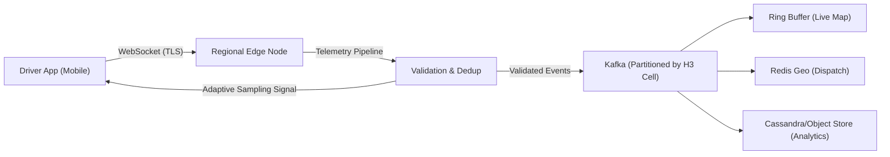

## Architecture Overview

The architecture follows a microservices pattern where each core concern, location tracking, trip management, payments, and surge pricing, lives in its own service. Services communicate through an API gateway for synchronous requests and through Kafka for asynchronous event-driven workflows. This separation means each service can scale independently based on its specific load profile. For example, the location service handles millions of writes per second while the payment service processes only hundreds.

```
Rider/Driver App
       │
       ▼
┌──────────────────────────────────────────┐
│           API Gateway / Load Balancer    │
│   (WebSocket for real-time, REST/gRPC)   │
└──┬───────────────┬────────────────┬──────┘
   │               │                │
   ▼               ▼                ▼
Location        Trip           Payment
Service         Service         Service
(Redis Geo)     (Postgres)      (Stripe/internal)
   │               │                │
   ▼               │                │
Driver          Trip State      Earnings
Matching        Machine         Service
Service            │
   │               ▼
   │          Event Bus (Kafka)
   │               │
   ▼               ▼
Surge           Notification
Pricing         Service
Engine          (FCM/APNs)
(Redis)
   │
   ▼
H3 Geo-index
(demand/supply
 per hex cell)
```

### The Ingestion Edge and the Three Masters Architecture

In the architectural teardown [Uber Architecture - Part 1: Why Tracking 5 Million Drivers Every Second Is One of Tech’s Hardest Problems](https://medium.com/@simranjeetsingh1497/uber-architecture-part-1-why-tracking-5-million-drivers-every-second-is-one-of-techs-hardest-6ca606892497) and [Part 2: The Ingestion Edge](https://medium.com/@simranjeetsingh1497/uber-architecture-part-2-the-ingestion-edge-840456c40f01), systems engineer Simranjeet Singh analyzes why conventional database ingestion fails at global scale.

With 5 million active drivers globally reporting GPS coordinates at 1Hz, the platform receives a continuous baseline of **83,000 writes every second**. Storing these pings directly into a relational or document database would require multiple times the capacity of a high-end PostgreSQL instance before accounting for geospatial indexing, replication overhead, or concurrent reads.

#### 1. The Three Masters Problem

A single incoming GPS coordinate stream must satisfy three competing consumers with fundamentally conflicting access patterns:

| Consumer | Access Pattern | Latency Budget | Scope |
| :--- | :--- | :--- | :--- |
| **Rider Map Rendering** | Point lookup | < 1.0 second | 1 driver at a time (matched driver) |
| **Dispatch Engine** | Geospatial range query | < 100 milliseconds | Dozens of candidates in an H3 hexagonal cell |
| **Analytics & Surge** | High-throughput batch/stream | Seconds to minutes | Global fleet historical movement data |

Because no single database engine simultaneously maximizes write throughput, read latency, and cost-effective multi-month retention, the architecture decomposes storage into purpose-built tiers: in-memory ring buffers for live map rendering, Redis H3 geospatial indexes for dispatch matching, and Cassandra/S3 for historical analytics.

#### 2. The Ingestion Edge

To protect backend storage tiers from raw telemetry traffic, a dedicated stateless edge layer intercepts all incoming pings:



Key architectural principles implemented at the ingestion edge include:

- **Regional Failure Bulkheads**: Driver mobile applications connect to local edge nodes in their respective metropolitan regions rather than a centralized data center. If central Kafka clusters experience transient partitions, regional edge nodes buffer events locally, containing the failure blast radius.
- **Protocol Selection (WebSocket over UDP)**: While UDP eliminates handshake overhead, mobile networks suffer variable packet loss. Rebuilding reliability, ordering, and session lifecycle tracking on UDP recreates a custom TCP implementation. WebSocket over TCP enables bidirectional communication, heartbeat-based dead-connection pruning, and server-pushed configuration changes.
- **Server-Driven Adaptive Sampling**: Drivers traveling at 100 km/h cover ~28 meters per second and require 1Hz GPS pings for smooth map interpolation. Conversely, stationary vehicles waiting at traffic signals generate redundant coordinates. Edge nodes monitor vehicle velocity and emit control frames adjusting the client's ping rate (e.g., dropping to once every 4 seconds while stationary). This adaptive throttling cuts edge ingestion load by over 40% without compromising tracking accuracy.

---
